# Boundary Box Arena — Architecture

This document explains how the turf booking system works and how it is built. It is written for a senior engineer who cannot see the code. Every claim was checked against the code on `main` at commit `28f1efd` (19 Nov 2026) plus the fixes SEC-44 → SEC-48 made the same day after this document's first draft found them. File paths are relative to the repository root. Function names are given as `file › function()`.

Contents

1. [One-page overview](#1-one-page-overview)
2. [System architecture](#2-system-architecture)
3. [Folder and file map](#3-folder-and-file-map)
4. [Data model](#4-data-model)
5. [State machines](#5-state-machines)
6. [Core flows](#6-core-flows)
7. [Pricing and policy engine](#7-pricing-and-policy-engine)
8. [Auth, sessions and permissions](#8-auth-sessions-and-permissions)
9. [API reference](#9-api-reference)
10. [Security controls summary](#10-security-controls-summary)
11. [Configuration](#11-configuration)
12. [Background jobs and external integrations](#12-background-jobs-and-external-integrations)
13. [Testing and CI](#13-testing-and-ci)
14. [Deployment and operations](#14-deployment-and-operations)
15. [Known limitations, risks and differences from the plan](#15-known-limitations-risks-and-differences-from-the-plan)

---

## 1. One-page overview

### What it does

Boundary Box Arena is a booking website for one sports venue with one box-cricket court and two pickleball courts.

- **Customers** pick a sport, date, court, start time and length (1–4 hours), verify their mobile number with a 6-digit code, and pay an advance online. They get a booking code, a status page and WhatsApp messages. They can cancel online under a configurable refund policy.
- **Staff** use a phone-friendly dashboard at the ground: schedule, bookings list, walk-in / phone bookings, marking balance paid, completed or no-show.
- **The owner** also controls prices, hours, blocked slots, holidays, customers, gallery, settings, staff accounts, the message outbox and the audit log.

New customers get a first-booking discount (default 10 %), limited to one per mobile number and one per browser.

### Tech stack

| Area | Choice | Where |
|---|---|---|
| Framework | Next.js 16.4.6 (App Router, Turbopack), React 19.3 | `package.json`, `app/` |
| Language | TypeScript 5.9 (strict) | `tsconfig.json` |
| Database | PostgreSQL. Live: any Postgres via `DATABASE_URL` (Supabase intended). Local/demo: PGlite (Postgres compiled to WASM) | `db/client.ts` |
| ORM | Drizzle ORM 0.45 for queries; raw SQL files for migrations | `db/schema.ts`, `db/migrations/` |
| Validation | Zod 4 | `lib/validation.ts` and inline in routes |
| Styling | Tailwind CSS 4; custom components (no shadcn/ui); fonts Barlow Condensed + Manrope via `next/font` | `app/globals.css`, `components/ui/` |
| Customer auth | Phone OTP → signed httpOnly cookie (30 min); trusted-device cookie (90 days) | `lib/auth/phone.ts`, `lib/auth/trusted-device.ts` |
| Admin auth | bcrypt passwords, DB-backed sessions, CSRF double-submit, phone-code 2FA, recovery codes | `lib/auth/admin.ts`, `lib/auth/admin-core.ts` |
| Payments | Razorpay (Orders, Checkout, Webhooks, Refunds) or a local mock with the same signatures | `lib/providers/payment.ts` |
| Messaging | WhatsApp via Meta Cloud API or a generic BSP, or mock; DB outbox with retries | `lib/providers/messaging.ts`, `lib/messaging/` |
| OTP delivery | mock, WhatsApp template, or MSG91 SMS | `lib/providers/otp.ts` |
| Bot protection | Cloudflare Turnstile on "send code" | `lib/turnstile.ts` |
| Image storage | Postgres `bytea` (default) or Supabase Storage; images re-encoded with `sharp` | `lib/storage.ts` |
| Limiter / cache store | Postgres tables by default; Upstash Redis optional for the fixed-window counters | `lib/counter.ts`, `lib/ratelimit.ts` |
| Hosting (intended) | Vercel (Node runtime) + Vercel Cron | `vercel.json` |
| Testing | Vitest 5 (unit, integration, security, concurrency), Playwright 1.65 (e2e + HTTP security, desktop + mobile) | `tests/` |
| CI | GitHub Actions: tests, real-Postgres races, Playwright, gitleaks, semgrep, npm audit, ZAP | `.github/workflows/security.yml` |

### Current state

- **Done:** public site, booking with OTP, advance payment, cancellation and refunds, WhatsApp outbox, full admin dashboard, four security rounds (SEC-01 → SEC-48 in `SECURITY_REPORT.md`), tests, CI workflow, staging smoke checklist.
- **Demo mode** (`DEMO_MODE` unset or `true`): mock payment ("Simulate success/failure"), mock OTP shown on screen, mock WhatsApp, a demo banner, demo admin accounts.
- **Live mode** (`NODE_ENV=production` and `DEMO_MODE=false`): the server refuses to start unless real providers, secrets and Turnstile are configured (section 10).
- **Not production-verified:** no real Razorpay, WhatsApp, MSG91, Turnstile, Supabase or Upstash account has been used. Nothing has been deployed. The CI workflow was pushed on 19 Nov 2026 but its results have not been reviewed. The race tests have not been run against Supabase.

---

## 2. System architecture

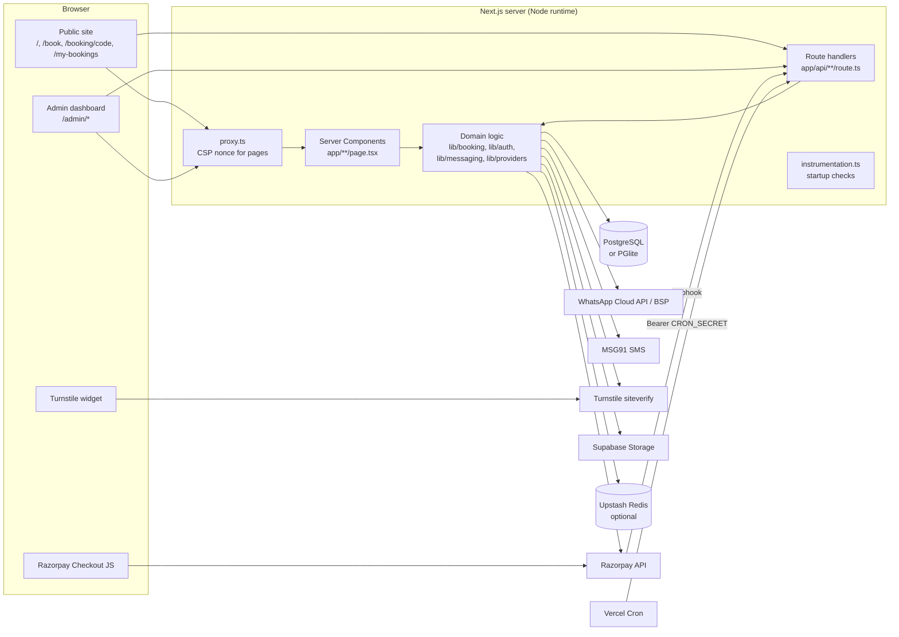

### Where each part runs

| Part | Runs in | Notes |
|---|---|---|
| `proxy.ts` | Next.js proxy (the Next 16 name for middleware) | Only adds a per-request CSP nonce to page requests. It does **no** authentication. API routes are excluded by its matcher. |
| Pages (`app/**/page.tsx`) | Node server (React Server Components) | Admin pages call `requireAdminPage()`; public pages read the DB directly through `lib/booking/data.ts`. |
| Route handlers (`app/api/**/route.ts`) | Node server | All writes go through these. There are **no Server Actions** (`"use server"` is not used anywhere). |
| Client components (`components/**`, `"use client"`) | Browser | Booking form, OTP input, payment panel, admin forms. They call the JSON API. |
| `instrumentation.ts › register()` | Node server, once at start | Runs `lib/startup-checks.ts › runStartupChecks()`. |
| Background work | Same Node process, after the response | `lib/background.ts › runInBackground()` uses `after()` from `next/server`. |
| Database | Postgres (live) or PGlite in-process (demo/tests) | PGlite is single-process and not for Vercel. |
| Cron | Vercel Cron calls two GET endpoints | `vercel.json`. |

### How requests are authenticated at each layer

| Layer | Customer | Admin | Machine |
|---|---|---|---|
| Proxy | none | none | none |
| Page | Booking status page reads the phone cookie to decide what to show | `requireAdminPage(minRole)` redirects to `/admin/login`, `/admin/account?force=1` or `/admin/bookings?denied=1` | — |
| Route handler | `getVerifiedPhone()` / `getPhoneProof()` reads the signed `bba_vp` cookie | `adminRoute(minRole, fn)` → `requireAdminApi()`: session cookie, role, forced-password-change, and for non-GET the CSRF header + Origin check | Razorpay webhook: HMAC of raw body. Cron: `Authorization: Bearer <CRON_SECRET>` |
| Domain logic | Booking ownership re-checked (`holdResponseFor()` compares phones) | Owner-only actions re-checked inside some routes (refunds) | Payment state machine re-checked under row locks |
| Database | Constraints (section 4) | — | — |

---

## 3. Folder and file map

```text
app/
  layout.tsx                 Root layout: fonts, metadata
  (site)/                    Public site (dark theme)
    layout.tsx               Header, footer, demo banner, mobile "Book" bar
    page.tsx                 Home: hero, live free slots, pricing, FAQ (policy text from Settings)
    book/page.tsx            One-page booking form (server shell → components/booking/booking-form.tsx)
    booking/[code]/page.tsx  Booking status: details, QR, payment panel, cancel box
    my-bookings/page.tsx     OTP → list of the customer's bookings
    gallery/page.tsx         Gallery grid with filters
    refund-policy/, terms/, privacy/, contact/   Legal pages
  admin/
    login/page.tsx, forgot/page.tsx              Login (2 steps) and password reset
    (panel)/                 Every page behind requireAdminPage()
      page.tsx               Overview (owner): today, revenue, occupancy, 7-day chart, heatmap, OTP usage
      schedule/, bookings/, walk-in/             Staff + owner
      blocked/, pricing/, courts/, customers/, gallery/, messages/, settings/, audit/, team/   Owner only
      account/               Password, phone, recovery codes (any admin)
  api/                       JSON route handlers (section 9)
components/
  booking/                   booking-form, otp-verify, payment-panel, cancel-booking, my-bookings, celebrate
  admin/                     shell (nav), schedule, bookings-table, booking-drawer, walk-in-form, settings-form,
                             login-form, recovery-codes, team-manager, account-forms, gallery-manager, …
  site/, ui/                 Public layout pieces; buttons, fields, icons
config/site.ts               Brand, phone, address, sports copy, FAQ, image URLs, booking-code prefix "BBA"
db/
  schema.ts                  Drizzle table definitions (mirror of the SQL)
  migrations/0001…0007       The source of truth for the schema and constraints
  migrate.ts                 Tiny runner: applies each .sql once, in name order
  client.ts                  getDb(): postgres-js or PGlite; transactionWithRetry()
  seed.ts                    Demo data; autoSeedIfEmpty() for PGlite only
  cli.ts                     npm run db:migrate | db:seed | db:reset
lib/
  booking/service.ts         ALL booking writes: holds, payment confirmation, refunds, cancel, walk-in, crons
  booking/data.ts            Reads: settings, courts, availability grid, booking lookup, netPaid()
  booking/slots.ts           Pure slot generation and selection checks
  booking/availability-cache.ts   12 s cache + shared version invalidation
  pricing/index.ts           Pure price, discount and advance maths
  policy.ts                  Cancellation/refund rules and every sentence that describes them
  otp.ts, otp-service.ts     OTP primitives; send/verify with limits and daily caps
  auth/                      phone, trusted-device, device, admin, admin-core, passwords, cron
  providers/                 payment, messaging, otp adapters
  messaging/                 outbox (index.ts) and templates
  ratelimit.ts, counter.ts, ip-limits.ts   Rate limiting (two mechanisms, section 10)
  security.ts                HMAC, signed tokens, constant-time compare, random codes
  errors.ts, validation.ts   AppError → JSON; Zod schemas; 32 KB body limit
  storage.ts                 Image sniffing, re-encoding, DB/Supabase storage
  startup-checks.ts, turnstile.ts, alerts.ts, audit.ts, background.ts, env.ts, time.ts
  admin/                     route wrapper, reports (overview, search), settings field list
proxy.ts                     CSP with nonce
next.config.ts               Security headers, no-store for /api and /admin
vercel.json                  Cron schedules
scripts/                     e2e server, concurrency runner, staging smoke checklist + script
tests/                       unit, integration, security, concurrency, e2e, support
.github/workflows/security.yml, .zap/rules.tsv
```

### Read these first (in order)

1. `db/migrations/0001_init.sql` — tables, the `no_overlap` constraint, all CHECKs.
2. `lib/booking/service.ts` — holds, payment confirmation, late payments, refunds, cancellation.
3. `lib/booking/data.ts` and `lib/booking/slots.ts` — how the slot grid is built.
4. `lib/pricing/index.ts` and `lib/policy.ts` — money rules.
5. `lib/otp-service.ts` — OTP limits and daily caps.
6. `lib/auth/phone.ts` and `lib/auth/trusted-device.ts` — customer identity.
7. `lib/auth/admin.ts` and `lib/auth/admin-core.ts` — admin sessions, 2FA, recovery codes.
8. `app/api/bookings/[code]/cancel/route.ts` — the fresh-OTP refund rule.
9. `lib/messaging/index.ts` — outbox and retries.
10. `lib/startup-checks.ts`, `proxy.ts`, `next.config.ts` — go-live guards and headers.

---

## 4. Data model

Money is whole rupees (`integer`). Times are `timestamptz` (UTC). Primary keys are text UUIDs (`gen_random_uuid()::text`) unless noted.

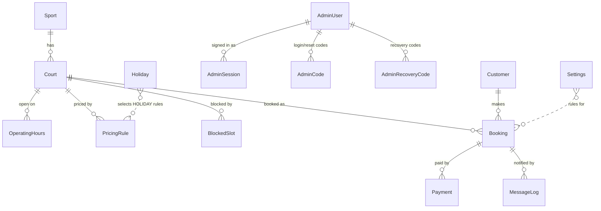

Tables with no foreign keys (stand-alone): `OtpRequest`, `AuditLog`, `RateLimitHit`, `Counter`, `CacheVersion`, `WebhookEvent`, `StoredFile`, `GalleryImage`, `Settings`, `_migrations`.

### Entities

**Sport**

| Column | Type | Constraints |
|---|---|---|
| id | text | PK |
| name | text | UNIQUE, CHECK in (`CRICKET`, `PICKLEBALL`) |
| description | text | default `''` |
| slotDurationMinutes | integer | default 60, CHECK 15–240 |
| sortOrder | integer | default 0 |

**Court** — `id` PK; `sportId` → Sport; `name`; `isActive` (default true); `sortOrder`.

**OperatingHours** — `courtId` → Court (cascade); `dayOfWeek` 0–6 (0 = Sunday); `openTime` `HH:MM`; `closeTime` `HH:MM` or `24:00`; `isClosed`. UNIQUE (`courtId`, `dayOfWeek`). CHECK `isClosed OR closeTime > openTime`.

**PricingRule** — `courtId` → Court (cascade); `dayType` in (`WEEKDAY`, `WEEKEND`, `HOLIDAY`); `startTime`; `endTime` (may be `24:00`); `pricePerSlot` 0–100000. CHECK `endTime > startTime`. Index (`courtId`, `dayType`).

**Holiday** — `date` (date, UNIQUE), `name`.

**BlockedSlot** — `courtId` → Court (cascade); `startAt`, `endAt` (CHECK end > start); `reason` in (`MAINTENANCE`, `TOURNAMENT`, `PRIVATE_EVENT`, `OTHER`); `note`; `recurrenceGroupId`; `createdBy`; `createdAt`. Index (`courtId`, `startAt`).

**Customer**

| Column | Type | Constraints / meaning |
|---|---|---|
| id | text | PK |
| name | text | |
| phone | text | UNIQUE, CHECK `^\+91[6-9][0-9]{9}$` |
| whatsappOptIn, optInAt | boolean, timestamptz | opt-in for customer messages |
| isBlocked, blockedAt, blockedReason | boolean, timestamptz, text | blocked numbers can't book online (0005) |
| trustEpoch | integer | bump to revoke trusted-device cookies (0006) |
| noShowResetAt | timestamptz | set on unblock; auto-block counts only no-shows for slots after it (0010) |
| createdAt | timestamptz | |

**OtpRequest** — `phone`; `codeHash` (HMAC); `expiresAt`; `attempts` (default 0); `consumedAt`; `ip`; `createdAt`. Index (`phone`, `createdAt DESC`).

**Booking**

| Column | Type | Constraints / meaning |
|---|---|---|
| id | text | PK |
| bookingCode | text | UNIQUE, `BBA-` + 8 chars |
| customerId | text | → Customer |
| courtId | text | → Court |
| startAt, endAt | timestamptz | CHECK end > start |
| status | text | CHECK in (`PENDING_PAYMENT`, `CONFIRMED`, `COMPLETED`, `EXPIRED`, `CANCELLED`, `REFUNDED`, `NO_SHOW`) |
| totalAmount, advanceAmount, balanceAmount | integer | each ≥ 0; CHECK advance + balance = total |
| discountAmount | integer | ≥ 0 (0002); total is after discount |
| offerDeviceId | text | device that claimed the offer (0003); partial index where not null |
| balancePaidAt | timestamptz | |
| refundAmount | integer | default 0 |
| refundPendingAmount | integer | ≥ 0 (0008); refund still owed after a failed refund call, retried by the cron |
| refundPendingSince, refundAttempts, refundNeedsManual | timestamptz, integer, boolean | give-up state for pending refunds: 24 h or 20 attempts → needs manual refund (0009) |
| source | text | CHECK in (`ONLINE`, `WALK_IN`, `PHONE`) |
| holdExpiresAt | timestamptz | set while `PENDING_PAYMENT` |
| cancelledAt, cancelReason | | |
| idempotencyKey | text | UNIQUE |
| reminderSentAt, notes, createdAt, updatedAt | | |

Indexes: (`courtId`, `startAt`), (`customerId`), (`status`, `holdExpiresAt`), (`offerDeviceId`) partial, (`refundPendingAmount`) partial where > 0.

**Payment**

| Column | Type | Constraints |
|---|---|---|
| bookingId | text | → Booking |
| provider | text | CHECK in (`razorpay`, `mock`, `CASH`, `UPI`, `CARD`) |
| kind | text | `ADVANCE` or `BALANCE` |
| providerOrderId | text | UNIQUE |
| providerPaymentId, providerRefundId | text | |
| amount | integer | ≥ 0 |
| status | text | CHECK in (`CREATED`, `PAID`, `FAILED`, `REFUNDED`) |
| refundAmount | integer | ≥ 0, CHECK refundAmount ≤ amount |
| paidAt, refundedAt | timestamptz | |
| rawWebhookPayload | jsonb | minimal subset only (SEC-17) |
| refundInFlightKey, refundInFlightAmount, refundInFlightAt | text, integer, timestamptz | a refund call whose outcome is unknown: its key (sent to Razorpay as `receipt` and `notes.refund_key`), reserved amount and start time (0009) |

Indexes: (`bookingId`), (`paidAt`).

**MessageLog** — `bookingId` → Booking (nullable); `phone`; `template`; `language` (default `en`); `payload` jsonb; `renderedText`; `status` in (`QUEUED`, `SENT`, `FAILED`, `MOCKED`); `provider`; `attempts`; `providerMessageId`; `error`; `dedupeKey` UNIQUE. Index (`createdAt DESC`).

**AdminUser** — `email` UNIQUE; `name`; `passwordHash` (bcrypt); `role` in (`OWNER`, `STAFF`); `isActive`; `phone` (CHECK same +91 pattern or null); `mustChangePassword`; `trustEpoch`; `passwordChangedAt`; `recoveryCodesAt`; `createdAt`.

**AdminSession** — `id` = SHA-256 of the session token (PK, not a UUID); `adminId` → AdminUser (cascade); `csrfToken`; `expiresAt`; `createdAt`.

**AdminCode** (0006) — `adminId` → AdminUser (cascade); `purpose` in (`RESET`, `LOGIN`); `codeHash`; `expiresAt`; `attempts`; `consumedAt`; `trustDevice`; `ip`; `createdAt`. Index (`adminId`, `createdAt DESC`).

**AdminRecoveryCode** (0007) — `adminId` → AdminUser (cascade); `codeHash`; `usedAt`; `createdAt`. UNIQUE (`adminId`, `codeHash`).

**AuditLog** — `actor`, `action`, `entity`, `entityId`, `before` jsonb, `after` jsonb, `createdAt`. Index (`createdAt DESC`). No update or delete path exists in the app.

**Settings** — exactly one row: `id` integer PK, CHECK `id = 1`. Columns and defaults are in section 11.

**RateLimitHit** — `id` bigserial PK; `key`; `createdAt`. Index (`key`, `createdAt`). One row per allowed request (sliding window).

**Counter** (0006) — `key` PK; `count`; `expiresAt`. Index (`expiresAt`). One row per key per fixed window.

**CacheVersion** (0006) — `key` PK; `version` bigint; `updatedAt`.

**WebhookEvent** — `id` PK (Razorpay event id or a derived id); `type`; `receivedAt`.

**StoredFile** — `contentType`; `data` bytea. **GalleryImage** — `url`; `storageKey`; `category` in (`CRICKET`, `PICKLEBALL`, `FACILITIES`); `alt`; `sortOrder`; `isFeatured`.

### Database-level protections

The exclusion constraint that makes double booking impossible (`db/migrations/0001_init.sql`):

```sql
CREATE EXTENSION IF NOT EXISTS btree_gist;
ALTER TABLE "Booking" ADD CONSTRAINT no_overlap
EXCLUDE USING gist (
  "courtId" WITH =,
  tstzrange("startAt", "endAt", '[)') WITH &&
) WHERE ("status" IN ('PENDING_PAYMENT', 'CONFIRMED'));
```

The range is half-open, so a 6–7 PM booking and a 7–8 PM booking do not overlap. A violation has SQLSTATE `23P01`; `lib/booking/service.ts` turns it into `SLOT_TAKEN` ("This slot was just taken, please pick another."). Note: an expired hold still has status `PENDING_PAYMENT` until something flips it, so every insert path first runs `expireStaleOverlapping()` in the same transaction.

| Protection | Where | What it guarantees |
|---|---|---|
| `no_overlap` exclusion | Booking | No two active (`PENDING_PAYMENT`/`CONFIRMED`) bookings overlap on a court |
| `advance + balance = total`, amounts ≥ 0 | Booking | Money columns stay consistent |
| `refundAmount ≤ amount` | Payment | Can't refund more than was paid on a payment |
| UNIQUE `bookingCode`, `idempotencyKey` | Booking | Duplicate submit returns the same hold |
| UNIQUE `providerOrderId` | Payment | One Payment row per gateway order |
| UNIQUE `dedupeKey` | MessageLog | The same message is never queued twice |
| UNIQUE `phone` | Customer | One customer per number |
| UNIQUE (`courtId`, `dayOfWeek`) | OperatingHours | One hours row per court per day |
| UNIQUE `date` | Holiday | |
| UNIQUE (`adminId`, `codeHash`) | AdminRecoveryCode | |
| `id = 1` | Settings | Single row |
| Phone pattern CHECKs | Customer, AdminUser | Only `+91` mobiles |
| Time format CHECKs | OperatingHours, PricingRule | `HH:MM`, close may be `24:00` |

Advisory locks (`pg_advisory_xact_lock(hashtext(key))`, released at transaction end):

| Key | Taken in | Purpose |
|---|---|---|
| `slot:<courtId>:<IST date>` | `service.ts › lockCourtDay()` from `createOnlineHold()`, `createAdminBooking()`, late-payment branch of `confirmPayment()`, and `createBlocks()` (every day a block touches, in sorted order) | Serialises booking and block inserts per court-day: parallel inserts queue instead of deadlocking (SEC-33), and a block and a hold can't both land on the same time (SEC-47) |
| `offer:<deviceId>` | `createOnlineHold()` | Only one hold per device can claim the first-booking offer |
| `rl:<key>` | `lib/ratelimit.ts › hitRateLimit()` | Exact sliding-window counts under bursts (SEC-07) |

Compare-and-set updates: `Payment.refundAmount + x ≤ amount` **and no refund in flight** reserves a refund and stores its key before the provider is called (`refundSinglePayment()`, SEC-49); `Booking.refundPendingAmount` is claimed by setting it to 0 only if unchanged (`retryPendingRefunds()`) (SEC-45).

Row locks (`SELECT … FOR UPDATE`): Customer row in `upsertCustomer()`; Payment then Booking in `confirmPayment()`; Booking in `cancelBooking()`, `markBalancePaid()`, `setBookingOutcome()`.

### Migrations (applied in name order by `db/migrate.ts`)

| File | What it does |
|---|---|
| `0001_init.sql` | All base tables, `btree_gist`, `no_overlap`, CHECKs, indexes |
| `0002_new_customer_discount.sql` | `Settings.newCustomerDiscountPercent` (default 10, 0–50); `Booking.discountAmount` |
| `0003_offer_device.sql` | `Booking.offerDeviceId` + partial index |
| `0004_two_hour_cancellation.sql` | Cancellation cutoff default 24 h → 2 h (and updates the row if it was 24) |
| `0005_abuse_limits.sql` | Per-phone booking limits, no-show threshold, single OTP daily cap; `Customer.isBlocked*` |
| `0006_followup_hardening.sql` | `Counter`, `CacheVersion`, `AdminCode`; split OTP caps + boost; per-IP limit settings; `cancelCutoffHours`, `refundPercentAfterCutoff`; renames `cancellationCutoffHours` → `refundCutoffHours`; drops `otpDailyCap`; `Customer.trustEpoch`; admin phone, forced change, trust epoch |
| `0007_admin_recovery_codes.sql` | `AdminRecoveryCode`; `AdminUser.recoveryCodesAt` |
| `0008_pending_refunds.sql` | `Booking.refundPendingAmount` (≥ 0) + partial index |
| `0009_refund_reconcile.sql` | Payment in-flight refund key/amount/time; Booking `refundPendingSince`, `refundAttempts`, `refundNeedsManual` |
| `0010_noshow_reset_autocomplete.sql` | `Customer.noShowResetAt`; `Settings.autoCompleteHours` (default 6, 0–72) |

`db/migration-list.ts` must list every file (a test checks); the live startup check uses it.

The runner wraps each file in `BEGIN … COMMIT` together with its `_migrations` insert. There are no down migrations.

---

## 5. State machines

### Booking status

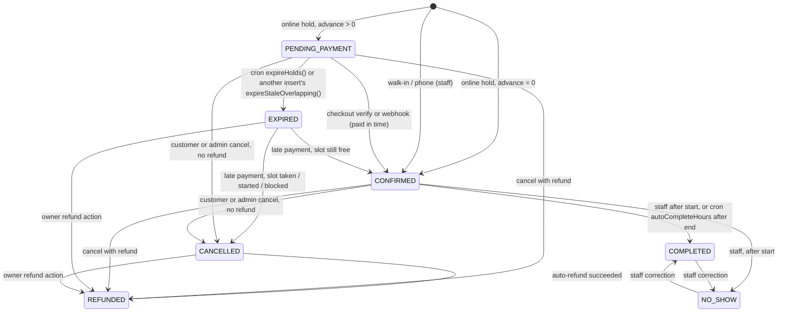

| Transition | Trigger | Code |
|---|---|---|
| → PENDING_PAYMENT / CONFIRMED | Customer holds a slot (status depends on whether advance is 0) | `service.ts › createOnlineHold()` |
| → CONFIRMED (staff) | Walk-in / phone booking | `createAdminBooking()` |
| PENDING_PAYMENT → CONFIRMED | `POST /api/payments/verify` or webhook `payment.captured` / `order.paid` | `confirmPayment()` |
| PENDING_PAYMENT → EXPIRED | Cron, or lazily by any later insert on that court range | `expireHolds()`, `expireStaleOverlapping()` |
| EXPIRED → CONFIRMED / CANCELLED → REFUNDED | Late payment | `confirmPayment()` (savepoint + court-day lock) |
| → CANCELLED / REFUNDED | Customer cancel (`by: CUSTOMER`) or admin cancel (`by: ADMIN`) | `cancelBooking()` |
| CONFIRMED ↔ COMPLETED / NO_SHOW | Staff action, only after `startAt` | `setBookingOutcome()` |
| CONFIRMED → COMPLETED (automatic) | Cron, `autoCompleteHours` (default 6) after `endAt`; never sets NO_SHOW | `autoCompleteBookings()` (SEC-59) |
| CANCELLED / EXPIRED → REFUNDED | Owner "refund" action on a booking that still holds money | `refundCancelledBooking()` (NO_SHOW stays NO_SHOW) |

Notes:

- The cron marks confirmed bookings `COMPLETED` `autoCompleteHours` after they end (0 turns it off). Staff can still switch COMPLETED ↔ NO_SHOW, and only staff can set NO_SHOW, so auto-blocking counts only staff-marked no-shows.
- `REFUNDED` means money went back; a cancellation with nothing to refund stays `CANCELLED`.
- If a refund call fails (customer cancel, admin cancel or late-payment auto-refund), the booking stays `CANCELLED` with `refundPendingAmount` set, `booking.refund_failed` is audit-logged and the owner is alerted. The 15-minute cron retries it; on success the booking becomes `REFUNDED` (SEC-45).
- A second payment for an already `CONFIRMED`/`COMPLETED` booking, or any payment for `CANCELLED`/`REFUNDED`/`NO_SHOW`, is refunded and the booking is not revived (`REFUND_NOT_BOOKABLE`).

### Payment status

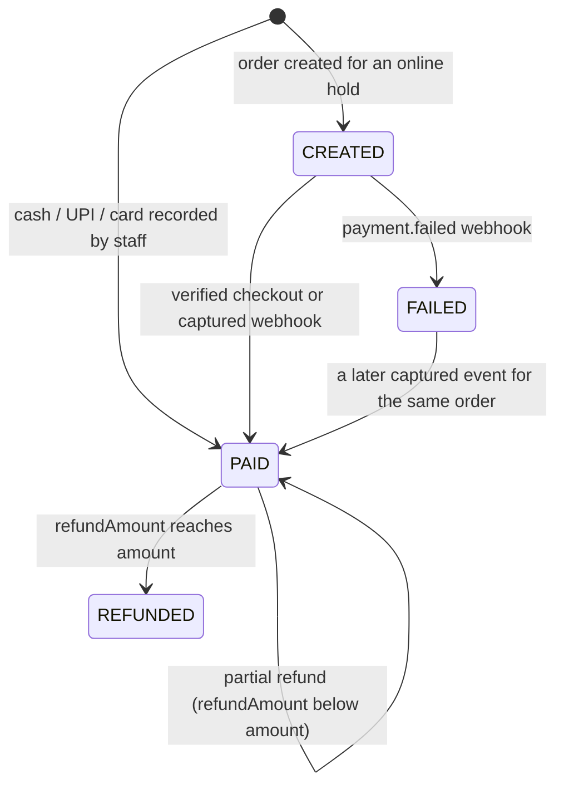

| Transition | Trigger | Code |
|---|---|---|
| → CREATED | First time a payable hold response is built, or "Retry payment" with no reusable order | `service.ts › ensureOrder()` |
| → PAID (online) | Row-locked in `confirmPayment()`; stores `providerPaymentId` and a minimal webhook payload | |
| → PAID (offline) | Walk-in with amount > 0 (`kind = ADVANCE`), or "mark balance paid" (`kind = BALANCE`) | `createAdminBooking()`, `markBalancePaid()` |
| CREATED → FAILED | Only from `CREATED`; sends the "payment failed, hold expiring" message if the hold is still live | `markPaymentFailed()` |
| PAID → REFUNDED | `refundSinglePayment()` when cumulative `refundAmount ≥ amount` | The amount is reserved (with a refund key) before the provider call. A definite failure (4xx) releases it; an unknown outcome (timeout, network, 5xx) keeps it until the cron finds the refund by key or confirms it doesn't exist (SEC-49) |

An open `CREATED` order is reused only if it has the same provider and the same amount as the current advance.

### OTP request lifecycle

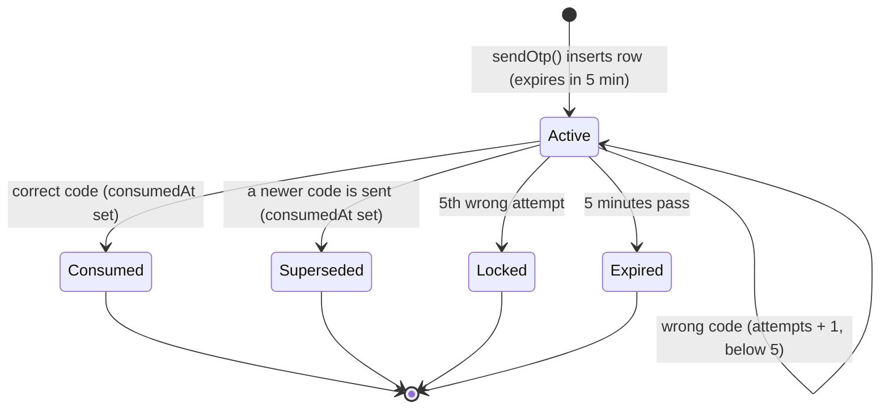

Only the newest row per phone is checked (`otp-service.ts › verifyOtp()`). Attempts are counted with a compare-and-set update (`WHERE attempts = <read value> AND consumedAt IS NULL`), so parallel guesses can't exceed 5.

Admin login/reset codes (`AdminCode`) follow the same shape: 5-minute (LOGIN) or 10-minute (RESET) expiry, 5 attempts, single use, older unused codes of the same purpose consumed when a new one is issued.

---

## 6. Core flows

### 6.1 Viewing availability

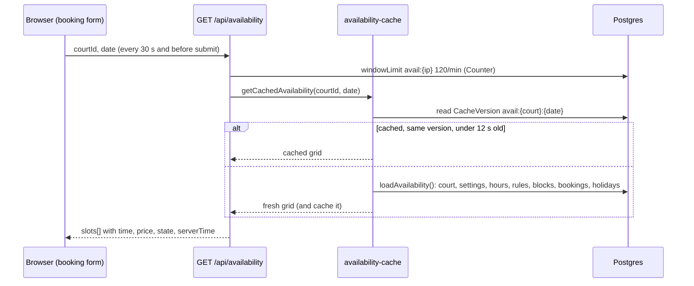

1. `app/api/availability/route.ts` checks the fixed-window limit `avail:<ip>`: 120 requests per 60 s, shared store (Postgres `Counter`, or Upstash). Over the limit → 429 with the network-limit message.
2. Zod checks `courtId` (1–64 chars) and `date` (`YYYY-MM-DD`).
3. `lib/booking/availability-cache.ts › getCachedAvailability()` reads the shared version for `avail:<courtId>:<IST date>`. If the per-instance in-memory entry has the same version and is younger than 12 000 ms, it is returned.
4. Otherwise `lib/booking/data.ts › loadAvailability()` builds the grid:
   - Court must exist and be active, else 404 "This court is not available for booking."
   - Customer view: dates from today (IST) to today + `maxDaysAhead` − 1; other dates return no slots.
   - Loads that weekday's hours, all pricing rules for the court, blocks and bookings overlapping the IST day (`PENDING_PAYMENT`, `CONFIRMED`, `COMPLETED`, `NO_SHOW`), and whether the date is a holiday.
   - `lib/booking/slots.ts › generateSlots()` walks from open to close in `slotDurationMinutes` steps (60 for both sports). Each slot is `PAST` (started), `BLOCKED` (overlaps a block, or no price rule covers it), `BOOKED` (overlaps an active booking; an expired hold counts as free) or `AVAILABLE`.
5. Invalidation: an entry is valid only while three shared versions are unchanged (SEC-60): `avail:<court>:<day>` (bumped by `invalidateAvailability()` after a hold, a payment outcome other than a plain confirm, a cancel, a walk-in, block creation/deletion and cron expiry), `availcfg:<court>` (bumped by `invalidateCourtConfig()` when pricing, hours, name or active flag change) and `availcfg:all` (bumped by `invalidateAllAvailability()` when holidays or Settings change). So every edit shows on the next poll.
6. The form re-polls every 30 s (`components/booking/booking-form.tsx`). The hold step re-validates against live data inside its own transaction, so a stale grid can never cause a double booking. If the server's total or advance differs from what the form showed (price edited, or the offer no longer applies), the form shows "Price updated" with the server's amounts and doesn't open payment by itself (SEC-61).

Failure paths: DB error → 500 generic message. Version read failure is not caught in `getCachedAvailability()` (only invalidation swallows errors).

### 6.2 Phone OTP send and verify

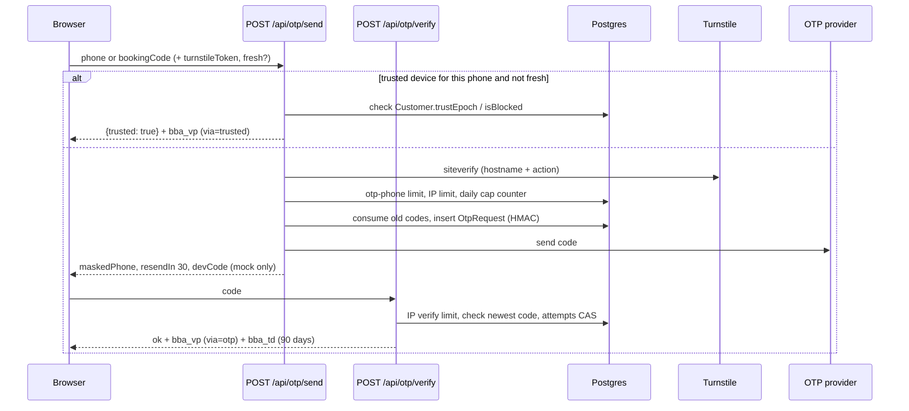

Send (`app/api/otp/send/route.ts`, `lib/otp-service.ts › sendOtp()`):

1. Body is `{ phone }` or `{ bookingCode }` (the booking's phone is used; it is never returned unmasked).
2. **Trusted-device skip** (SEC-35): if `fresh` is not `true` and the `bba_td` cookie is valid for this exact phone with the current `trustEpoch` and the customer is not blocked, the server sets `bba_vp` with `via = "trusted"` and returns `{ trusted: true }`. No code is sent and no cap is used.
3. **Turnstile** (SEC-09/34): if `TURNSTILE_SECRET_KEY` is set, the token must verify with `success`, action `otp_send` and a hostname in `TURNSTILE_HOSTNAMES` (or the site host). Network errors fail closed. 8 s timeout. Failure → 403.
4. **Per number:** `otp-phone:<phone>` 3 per 15 min (sliding window). Failure → 429 "Too many codes requested for this number. Please try again in 15 minutes."
5. **Per network:** `otp-send-ip:<ip>` `Settings.otpSendPerIpHour` (default 30) per hour.
6. **Daily cap pool:** "returning" if the number has a `CONFIRMED`/`COMPLETED` booking starting within the last 90 days (or upcoming); otherwise "new". Cap = `otpDailyCapNew` (200) or `otpDailyCapReturning` (300), plus `otpCapBoost` if `otpCapBoostDate` is today (IST). The counter `otpcap:<pool>:<IST date>` is incremented first. At ≥ 80 % and at ≥ 100 % the owner gets one alert each per pool per day. If the new count is above the cap → 429 "We can't send codes right now. Please call the venue to book."
7. Older unused codes for the phone are marked consumed. A new row stores `HMAC-SHA256(APP_SECRET, "otp:<phone>:<code>")`, `expiresAt = now + 5 min`, and the IP.
8. `lib/providers/otp.ts › deliverOtpCode()` sends the code over `OTP_PROVIDER`. WhatsApp gets **one** attempt with a 5-second deadline and no backoff (`lib/messaging/index.ts › dispatchOnce()`, SEC-50). If that channel fails and `MSG91_AUTH_KEY` + `MSG91_OTP_TEMPLATE_ID` are set, the code goes by SMS instead. If every channel fails, the new code is withdrawn (marked consumed) and the customer gets 502 `PROVIDER_ERROR` instead of "code sent" (SEC-46). The mock returns `devCode`, which the demo UI shows.

Verify (`app/api/otp/verify/route.ts`, `verifyOtp()`):

1. Per-network limit `otp-verify-ip:<ip>` `otpVerifyPerIpHour` (60) per hour.
2. Reads the newest code for the phone. Checks consumed / expired / 5 attempts, then constant-time compares the HMAC.
3. Counts the attempt with a compare-and-set update. Wrong code → "Incorrect code. N attempts left."; 5th wrong → `OTP_LOCKED`.
4. On success sets `bba_vp` (30 min, `via = "otp"`, `at = now`) and `bba_td` (90 days).

### 6.3 Creating a booking hold

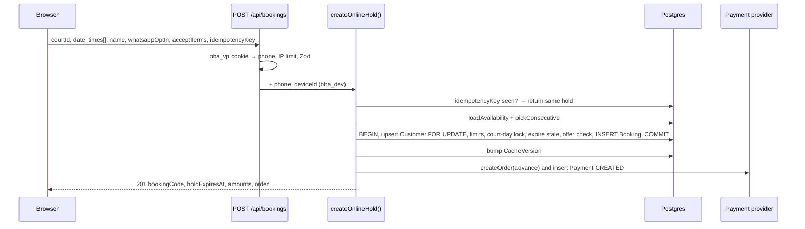

1. `app/api/bookings/route.ts` requires `bba_vp`; otherwise 401 `PHONE_NOT_VERIFIED`.
2. Per-network limit `booking-ip:<ip>` `bookingPerIpHour` (60) per hour. When it trips, the owner gets a `booking_flood` alert (once per day).
3. Zod (`createBookingSchema`): `times` 1–8 entries `HH:MM`; name 2–50 after sanitising; `acceptTerms` must be `true`; `idempotencyKey` 8–100 chars. Any price or status fields sent by the client are ignored.
4. `createOnlineHold()` returns the existing hold if the idempotency key was already used.
5. Builds the live grid and `pickConsecutive()`: every time must exist, be `AVAILABLE` and be consecutive. Errors: `SLOT_TAKEN`, "Please choose back-to-back slots.", "Please choose at least one slot.", unknown slot.
6. One transaction (`transactionWithRetry`, up to 4 tries on deadlock/serialisation errors):
   - upsert the Customer and lock its row;
   - `enforceBookingLimits()`: blocked → generic "call us" message; at most `maxActiveBookingsPerPhone` (2) upcoming bookings; at most `maxBookingsPerPhonePerDay` (4) bookings created in the last 24 h (expired holds excluded, cancelled ones included);
   - `lockCourtDay()`; `assertNotBlocked()` re-reads blocks under the lock, because the grid was read before the transaction and blocks are not in the exclusion constraint (SEC-47); `expireStaleOverlapping()`;
   - first-booking offer: if the discount is on, a device id exists and the number is new, take the `offer:<device>` lock and grant the discount only if the device hasn't used it;
   - `priceBreakdown()`; insert the booking as `PENDING_PAYMENT` with `holdExpiresAt = now + holdMinutes` (10), or `CONFIRMED` if the advance is 0.
7. `23P01` → `SLOT_TAKEN`. `23505` (idempotency race) → return the winner's hold.
8. Invalidate the availability cache. If already confirmed, queue the confirmation messages.
9. `holdResponseFor()` creates or reuses the payment order and returns amounts, `holdExpiresAt` and the order.

Failure paths: provider error while creating the order → 502 `PROVIDER_ERROR`, but the hold already exists; the status page's "Retry payment" (`POST /api/bookings/[code]/pay`) creates the order later.

### 6.4 Payment

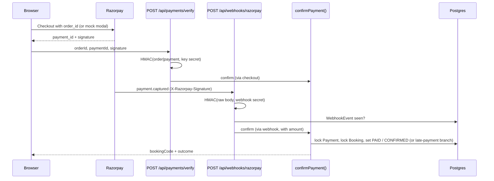

1. Order creation: `ensureOrder()` → `RazorpayProvider.createOrder()` posts `amount` in paise, `currency: INR`, `receipt: <bookingCode>`. A `Payment` row is stored as `CREATED`.
2. Checkout: `components/booking/payment-panel.tsx` loads `https://checkout.razorpay.com/v1/checkout.js`. With the mock provider, `POST /api/payments/mock/simulate` plays Razorpay: it fires a correctly signed webhook into the real handler and returns a correctly signed checkout response.
3. `POST /api/payments/verify` checks `HMAC_SHA256(key_secret, "<order_id>|<payment_id>")` in constant time. Bad → 400 `INVALID_SIGNATURE`. No amount is passed on this path; the signature binds the order.
4. `POST /api/webhooks/razorpay` reads the raw body, verifies `X-Razorpay-Signature` = `HMAC_SHA256(webhook_secret, raw body)`, parses JSON, and takes the event id from `X-Razorpay-Event-Id` (or derives `<event>:<payment id>`). A known event id returns `{duplicate: true}`. `payment.captured` and `order.paid` call `confirmPayment()` with the amount; `payment.failed` calls `markPaymentFailed()`. The event id is inserted **after** processing.
5. `confirmPayment()` (one transaction with retry):
   - lock the Payment by `providerOrderId` (unknown → 404), then the Booking;
   - already `PAID`/`REFUNDED` → `ALREADY_PROCESSED` (this is what makes the callback + webhook race safe);
   - amount differs from `amount × 100` → audit `payment.amount_mismatch`, outcome `AMOUNT_MISMATCH`, nothing confirmed;
   - mark the Payment `PAID` with a minimal payload (event, id, order, amount, status, method);
   - booking `PENDING_PAYMENT` → `CONFIRMED`;
   - booking `EXPIRED` (late payment) → in a savepoint: court-day lock, expire stale holds, refuse if the slot has started or is blocked, try to set `CONFIRMED` (the constraint decides). Success → `CONFIRMED_LATE`. Constraint or rule failure → booking `CANCELLED`, outcome `REFUND_SLOT_TAKEN`;
   - booking already live, or cancelled/refunded/no-show → `REFUND_NOT_BOOKABLE`.
6. After commit: confirmed → queue confirmation + owner alert. Refund outcomes → `refundSinglePayment()` for the full payment; if the booking wasn't live it becomes `REFUNDED` and the customer gets the cancellation message.

Failure paths: the refund runs after the transaction commits, with a stored refund key. If the refund call fails or its outcome is unknown, the webhook still returns 200 (a Razorpay retry would see `ALREADY_PROCESSED` and could never refund), and the money owed is recorded in `Booking.refundPendingAmount` with a `booking.refund_failed` audit entry and an owner alert. The booking stays `CANCELLED` until the cron's retry succeeds; then it becomes `REFUNDED` and the customer gets the cancellation message (SEC-45).

### 6.5 Hold expiry and reminder crons

1. `GET /api/cron/expire-holds` (every minute): `assertCron()`, then `expireHolds()` sets every `PENDING_PAYMENT` with `holdExpiresAt ≤ now` to `EXPIRED` and bumps the cache version for each.
2. `GET /api/cron/send-reminders` (every 15 min): `expireHolds()` again (safety net), then `sendReminders()`, then `redispatchStuck()`, then `retryPendingRefunds()`.
   - `sendReminders()` claims bookings with one `UPDATE … SET reminderSentAt = now WHERE status = CONFIRMED AND reminderSentAt IS NULL AND startAt in (now, now + 2 h] RETURNING id`, so two overlapping runs can't both send. Each gets a `booking_reminder` message (dedupe key `booking_reminder:<id>`), only if opted in.
   - `redispatchStuck()` re-sends up to 50 messages stuck in `QUEUED` for more than 2 minutes. Masked OTP messages are marked `FAILED` ("Expired before delivery") instead.
   - `reconcileInFlightRefunds()` (runs first) takes refunds whose outcome was unknown and are older than 1 minute, lists the payment's refunds at Razorpay (`GET /v1/payments/{id}/refunds`) and matches our key: found → recorded as refunded; not found → the reservation is released so the retry below can try again; lookup failed → next run (SEC-49).
   - `autoCompleteBookings()` marks confirmed bookings `COMPLETED` `autoCompleteHours` after `endAt` (SEC-59); `cleanupLimiterTables()` deletes `RateLimitHit` rows older than 48 h and expired `Counter` rows, at most 10 000 of each per run (SEC-58).
   - `retryPendingRefunds()` takes up to 20 bookings with `refundPendingAmount > 0` that haven't given up. After 20 failed attempts or 24 hours since the first failure it marks the booking `refundNeedsManual`, stops retrying and sends the owner one alert; the Overview page then shows it under "Refunds needing attention" with a "Mark refunded" button (owner, audit-logged, `markRefundedManually()`).
   - Otherwise it claims each pending amount by setting it to 0 only if unchanged (so overlapping runs can't both refund), refunds it online-first, and puts back whatever still fails, counting the attempt, with another owner alert (one per booking per day). Success adds to `refundAmount`, sets `REFUNDED` for cancelled/expired bookings and sends `booking_cancelled` (SEC-45).
3. Correctness never depends on the crons: availability treats expired holds as free, and inserts expire overlapping stale holds themselves.

### 6.6 Customer cancellation

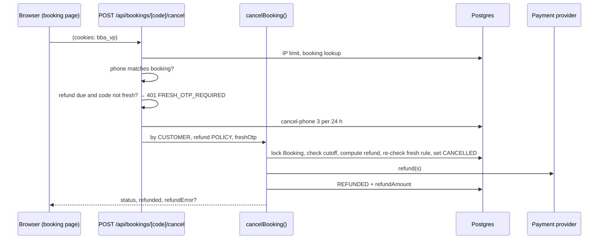

1. Per-network limit `cancel-ip:<ip>` `cancelPerIpHour` (30) per hour.
2. Booking must exist (404). `bba_vp` must exist (401) and match the booking's phone (403).
3. **Fresh-OTP rule** (SEC-43): `isFreshOtp()` is true only if the cookie says `via = "otp"` and the code was verified within 10 minutes (`FRESH_OTP_MS`). If the policy would refund money (`previewCustomerRefund()`), a non-fresh proof → 401 `FRESH_OTP_REQUIRED`. This check runs before the daily cancel counter so a refused try doesn't use one up.
4. `cancel-phone:<phone>` 3 per 24 h → "You've cancelled several bookings today. Please call the venue for help."
5. `cancelBooking()` (one transaction, Booking row lock):
   - only `CONFIRMED` or `PENDING_PAYMENT` can be cancelled;
   - customer cancels must be more than `cancelCutoffHours` (0) before start;
   - refund = `refundFor()` on the net paid amount (`refundPercentBeforeCutoff` 100 % if at least `refundCutoffHours` (2) before start, else `refundPercentAfterCutoff` 0 %);
   - customer + refund > 0 + not fresh → `FRESH_OTP_REQUIRED` again (the "double check", using the exact figure inside the lock);
   - set `CANCELLED`, audit `booking.cancel`.
6. After commit: invalidate the cache; `tryRefundBooking()` refunds online payments first. Success → booking `REFUNDED`. Failure → stays `CANCELLED`, the unpaid part goes to `refundPendingAmount` (retried by the cron), audit `booking.refund_failed`, owner alert, and the response carries `refundError` (the customer is told the refund will be retried).
7. Sends `booking_cancelled` if the booking had an advance, wasn't online, or a refund was made.

The UI (`components/booking/cancel-booking.tsx`) always asks for a new code (`fresh: true`) when a refund is due.

### 6.7 Admin login

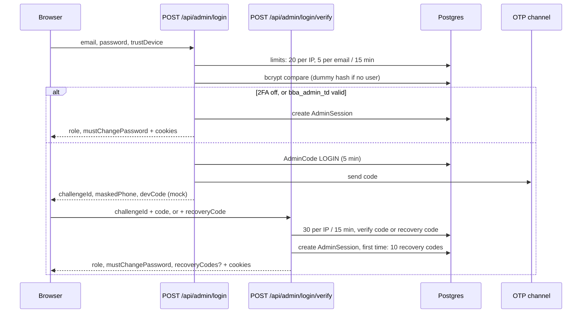

1. `lib/auth/admin.ts › loginAdmin()`: rate limits `admin-login-ip:<ip>` 20 / 15 min and `admin-login:<email>` 5 / 15 min (checked before the password). The password is compared with bcrypt; unknown emails are compared against a dummy hash so timing doesn't reveal accounts. Wrong, unknown or disabled → 401 "Incorrect email or password."
2. 2FA is required when `ADMIN_2FA_REQUIRED=true`, or by default when `NODE_ENV=production` and `DEMO_MODE=false` (`admin-core.ts › admin2faRequired()`).
3. If not required, or the `bba_admin_td` cookie is valid for this admin and its `trustEpoch`, a session is created straight away.
4. Otherwise `issueAdminCode(admin, "LOGIN")` stores an HMAC of the code (`admin:LOGIN:<adminId>:<code>`), 5-minute expiry, and the `trustDevice` wish. Delivery uses `deliverOtpCode()`: the OTP provider first, MSG91 SMS if that fails and its keys exist (SEC-46). Admin codes don't count against customer caps. No phone on the account → 409 "No phone number is set for this account."
5. `verifyAdminLogin()`: limit `admin-2fa-ip:<ip>` 30 / 15 min. Either `verifyAdminCode()` (bound to the challenge's admin and purpose, 5 tries, single use) or `verifyRecoveryLogin()` (section 6.8).
6. `createSession()`: deletes expired sessions, creates a random 32-byte token (cookie `bba_admin`) and stores only its SHA-256 as the session id, with a random 24-byte CSRF token (cookie `bba_csrf`, readable by JS), 12 h expiry, audit `admin.login` with `via` = `password`, `trusted-device`, `2fa` or `recovery-code`.
7. If "trust this device" was ticked and the phone code (not a recovery code) was used, sets `bba_admin_td` for 30 days.
8. The first phone-code login of an admin with no recovery codes returns 10 new codes once (`ensureRecoveryCodes()`); the UI makes the admin confirm they saved them.
9. Accounts with `mustChangePassword` can only reach `/admin/account` and `PUT /api/admin/password` until they change it.

Lockout: 5 failed passwords lock that email for 15 minutes (SEC-29, accepted risk). 5 wrong codes lock the challenge; the admin starts again from the password step.

### 6.8 Admin password change, forgot password, recovery codes

Password change (`PUT /api/admin/password`, `admin-core.ts › changePassword()`):

1. Any signed-in admin, allowed while a change is forced. Limit `admin-pw-change:<adminId>` 10 per hour.
2. Current password must match. New password: 10–200 chars, not in the common list, not one repeated character, doesn't contain the email's local part (if 4+ chars). Must differ from the current one.
3. bcrypt hash (cost `BCRYPT_COST`, default 12), clears `mustChangePassword`, sets `passwordChangedAt`, bumps `trustEpoch` (all trusted admin devices need a code again), deletes every other session (keeps the current one), audit `admin.password_change`, owner alert.

Forgot password (`/admin/forgot`):

1. `POST /api/admin/password {email}`: limit `admin-reset-ip:<ip>` 10 per hour (visible). Then, silently, `admin-reset:<email>` 3 per hour; if allowed and the account is active with a phone, a 6-digit RESET code (10 min) is sent. The response is always "If this account exists, a code has been sent to its registered phone."
2. `PATCH /api/admin/password {email, code, newPassword}`: limit `admin-reset-verify-ip:<ip>` 20 per hour. Verifies the newest RESET code (5 tries, single use), applies the password rules, sets the password and deletes **all** sessions, bumps `trustEpoch`, audit `admin.password_reset`, owner alert.

Recovery codes (SEC-41, `admin-core.ts`):

1. Format `XXXXX-XXXXX` from `ABCDEFGHJKMNPQRSTUVWXYZ23456789` (no 0/O/1/I/L), drawn with `crypto.randomInt` (about 49.5 bits each). 10 per admin.
2. Stored as `HMAC-SHA256(APP_SECRET, "admin:recovery:<adminId>:<normalised code>")`. Shown once.
3. Made at the first phone-code login (`ensureRecoveryCodes()` claims `recoveryCodesAt` atomically so parallel logins can't make two sets) or from My account.
4. Login with a recovery code needs a live, unconsumed, unexpired LOGIN challenge (so the password is always required first). Each try counts against the challenge's 5 attempts. The code is consumed with `UPDATE … WHERE usedAt IS NULL RETURNING`. The device is never trusted. Audit `admin.recovery_code_used` with codes left; owner WhatsApp alert.
5. Regenerate: `POST /api/admin/account/recovery-codes {currentPassword}` deletes every old code and returns 10 new ones (audit `admin.recovery_codes_regenerated`).

### 6.9 Walk-in / phone booking by staff

1. `POST /api/admin/walk-in` (STAFF or OWNER, CSRF). Zod `walkInSchema`: 1–12 times, name, phone, `source` `WALK_IN`/`PHONE`, `amountReceived` 0–1 000 000, `paymentMode` `CASH`/`UPI`/`CARD`, optional notes ≤ 300.
2. `createAdminBooking()` builds the grid with `admin: true` (any date from today, slots that have started but not ended are allowed, no max-days limit) and checks the selection.
3. Total = sum of slot prices (no discount, no advance rule). Amount received can't exceed the total.
4. Transaction with retry: upsert customer, court-day lock, re-check blocks (`assertNotBlocked()`), expire stale holds, insert `CONFIRMED` with `advanceAmount = amountReceived`, `balanceAmount = total − received`, `balancePaidAt` set if fully paid. If amount > 0, a `PAID` Payment with the chosen mode. Audit `booking.create_admin`.
5. `23P01` → "That slot overlaps an existing booking."
6. Invalidate cache; queue the confirmation (if the customer opted in) and the owner alert.

Per-phone online limits and blocked-number checks do **not** apply to staff bookings.

### 6.10 No-show marking and automatic blocking

1. `POST /api/admin/bookings/[id] {action: "no_show"}` (STAFF or OWNER) → `setBookingOutcome(id, "NO_SHOW")`.
2. Allowed only for `CONFIRMED`, `COMPLETED` or `NO_SHOW` bookings and only after `startAt`.
3. If `noShowBlockThreshold` (3) > 0 and the customer now has at least that many `NO_SHOW` bookings for slots that started after `Customer.noShowResetAt` (all of them if never unblocked), the customer is set `isBlocked = true`, `blockedReason = "<n> no-shows"`, and `trustEpoch` is bumped (only if not already blocked). Audit `customer.auto_block`.
4. Blocked numbers get the generic "We can't take this booking online. Please call …" message at the hold step, and trusted-device skips stop working for them.
5. The owner can unblock from Customers (`PATCH /api/admin/customers`). Unblocking sets `noShowResetAt`, so the count starts again (SEC-57).

### 6.11 WhatsApp message sending

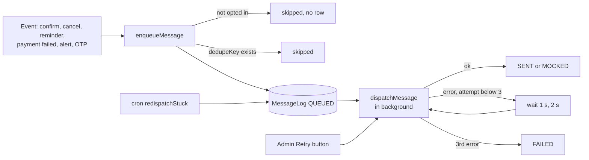

1. `lib/messaging/index.ts › enqueueMessage()` writes a `QUEUED` row only if `optedIn` is true. Customer messages pass the customer's `whatsappOptIn`; owner alerts and OTPs pass `true`.
2. Params are cleaned (`templates.ts › cleanParam()`: single line, names stripped of links and `<>{}`, max 120 chars, or 200 for `text`/`policy`). OTP codes are stored masked (`••••••`) when the WhatsApp OTP provider is used.
3. `dispatchMessage()` tries up to 3 times (`MAX_MESSAGE_ATTEMPTS`), sleeping `MESSAGE_RETRY_BASE_MS × 2^(n−1)` between tries (1 s, then 2 s by default). Each try updates `attempts` and `error`, and the function returns the final status (`SENT`, `MOCKED` or `FAILED`). A failed message never fails a booking; only OTP delivery treats `FAILED` as an error (SEC-46), and OTPs use `dispatchOnce()` (one try, 5 s deadline) so the SMS fallback starts quickly (SEC-50).
4. Providers: mock (status `MOCKED`), Meta Cloud API, generic BSP (section 12). Templates: `otp_code`, `booking_confirmed`, `booking_reminder`, `booking_cancelled`, `payment_failed_hold_expiring`, `admin_new_booking`, `admin_alert`, each in English and Telugu (`MESSAGE_LANGUAGE`).
5. Owner alerts (`lib/alerts.ts › alertOwner(kind, text)`): one `admin_alert` per kind per IST day (dedupe key `alert:<kind>:<date>`), only if `Settings.ownerAlertPhone` is set; also audit `security.<kind>`. Kinds in use: `otp_cap_new_80/100`, `otp_cap_returning_80/100`, `booking_flood`, and per-event kinds for password changes and recovery-code use (these include a timestamp so each one is sent).
6. Admin "Retry" (`POST /api/admin/messages/[id]/retry`, owner) resets attempts and dispatches again. Masked OTP rows can't be retried.
7. Customers can opt out or in themselves (`POST /api/my-bookings/whatsapp`); the owner can change it from Customers.

### 6.12 Gallery upload

1. `POST /api/admin/gallery` (OWNER, CSRF), multipart: `file`, `category` (`CRICKET`/`PICKLEBALL`/`FACILITIES`), `alt` (3–160 chars).
2. `lib/storage.ts › storeImage()`: max 4 MB; magic-byte sniffing (JPEG, PNG, WebP, AVIF); `sanitizeImage()` re-encodes with `sharp`: rejects over 40 MP and under 200 × 200 px, applies EXIF rotation, resizes to fit 2400 × 2400, outputs WebP quality 82 with all metadata dropped.
3. Storage: `STORAGE_PROVIDER=db` (default) stores bytes in `StoredFile` and returns URL `/api/files/<id>`; `supabase` uploads to `SUPABASE_URL/storage/v1/object/<bucket>/<path>` with the service-role key and returns the public URL.
4. A `GalleryImage` row is added at the end of the order; audit `gallery.upload`. PATCH edits alt/category/featured, PUT reorders (≤ 500 ids), DELETE removes the row and the stored object.
5. **Serving:** `GET /api/files/[id]` (`app/api/files/[id]/route.ts`) serves `db` images: 300 requests per minute per network (fixed window, SEC-51), the id must be a UUID, the file must belong to a `GalleryImage` row (join on `storageKey = 'db:<id>'`, SEC-51), only `image/*` rows are served, with `Cache-Control: public, max-age=31536000, immutable`, `nosniff`, a `default-src 'none'` CSP and `Cross-Origin-Resource-Policy: same-origin` (SEC-44). Supabase images are served by Supabase; `next.config.ts` allows `*.supabase.co/storage/v1/object/public/**` for `next/image`. Seed images use Unsplash URLs.

---

## 7. Pricing and policy engine

### How a price is calculated

All price maths is on the server in `lib/pricing/index.ts`. The client sends only court, date and start times.

1. **Day type** (`getDayType()`): `HOLIDAY` if the IST date is in `Holiday`; else `WEEKEND` for Saturday/Sunday; else `WEEKDAY`.
2. **Slot price** (`priceForSlot()`): a rule matches when `startTime ≤ slot start < endTime`. The slot is priced by its **start** time. Fallback chain: `HOLIDAY → WEEKEND → WEEKDAY`; `WEEKEND → WEEKDAY`. No match → the slot is shown `BLOCKED` and can't be booked.
3. **Multi-slot:** the subtotal is the sum of each 60-minute slot's price, so a booking that crosses 6 PM is part day rate, part night rate.
4. **Discount** (`discountFor()`): first-booking offer `floor(subtotal × percent / 100)`. Applied before the advance.
5. **Advance** (`computeAdvance()`): `FIXED` → `advanceValue` (default ₹300) capped at the total; `PERCENT` → `round(total × advanceValue / 100)`. Balance = total − advance.
6. There is **no convenience fee or tax line** in the code.

Seeded rules (`db/seed.ts`), the same for every day of the week, hours 06:00–23:00:

| Court | Day (06:00–18:00) | Night (18:00–24:00) | Weekend / holiday |
|---|---|---|---|
| Box Cricket Arena | ₹800 | ₹1200 | +₹200 |
| Pickleball Court 1 and 2 | ₹400 | ₹600 | +₹200 |

**Example 1 — new customer, cricket, Wednesday 5–7 PM (2 hours).** Slots 17:00 (day, ₹800) and 18:00 (night, ₹1200). Subtotal ₹2000. New number on a new device → 10 % off = ₹200. Total ₹1800. Fixed advance ₹300 now; balance ₹1500 at the venue. With `PERCENT 30` instead, the advance would be `round(1800 × 0.3)` = ₹540.

**Example 2 — returning customer, pickleball, Saturday 8–9 PM.** Weekend night: ₹600 + ₹200 = ₹800. No discount. Advance ₹300, balance ₹500.

Walk-ins (`createAdminBooking()`) use the same slot prices but no discount and no advance rule: the staff enters what was received.

### Cancellation and refund rules

One source: four Settings fields, read by `lib/policy.ts` (SEC-40).

| Field | Default | Meaning |
|---|---|---|
| `cancelCutoffHours` | 0 | Online cancelling closes this many hours before start (0 = until the slot starts) |
| `refundCutoffHours` | 2 | Cancel at least this many hours before start to get the "before" refund |
| `refundPercentBeforeCutoff` | 100 | % of the net paid amount refunded before the cutoff |
| `refundPercentAfterCutoff` | 0 | % refunded after the cutoff |

`refundFor()` = `round(netPaid × pct / 100)`, where `netPaid` is the sum over `PAID`/`REFUNDED` payments of `amount − refundAmount`. Admins choose full, partial or no refund instead (owner only for any refund).

Where the policy text is shown (all generated by `policyLines()`, `policySummary()` or `cancelledRefundText()`):

| Place | File |
|---|---|
| Refund policy page | `app/(site)/refund-policy/page.tsx` |
| Home page FAQ ("Can I cancel my booking?") | `app/(site)/page.tsx` (FAQ answer marker `POLICY` in `config/site.ts`) |
| Booking form, before paying | `app/(site)/book/page.tsx` → `components/booking/booking-form.tsx` |
| Booking status page, cancel box | `app/(site)/booking/[code]/page.tsx` → `components/booking/cancel-booking.tsx` |
| WhatsApp `booking_confirmed` ("Cancellation: …") | `service.ts › notifyConfirmed()` |
| WhatsApp `booking_cancelled` refund line | `service.ts › notifyCancelled()` |

A test (`tests/security/followup.test.ts`) greps the app for hardcoded cutoff hours or refund percentages.

### Time handling

- Every instant is stored as `timestamptz` (UTC). The venue runs on IST (UTC+05:30, no daylight saving), so `lib/time.ts` uses a fixed 330-minute offset.
- A "date key" is an IST calendar date `YYYY-MM-DD`. Opening hours and pricing rules are IST wall-clock `HH:MM`.
- `istToUtc(dateKey, minutes)` converts IST wall-clock to a UTC instant; `istDateKey(instant)` goes back. Display uses `Intl.DateTimeFormat` with `timeZone: "Asia/Kolkata"`.
- **Midnight edge case:** an IST day runs from 18:30 UTC the previous day to 18:30 UTC. `loadAvailability()` queries bookings and blocks between `istToUtc(date, 0)` and `istToUtc(date + 1, 0)`, so a 00:30 IST event belongs to the right day even though its UTC date is the day before. "Today" for the booking window and the OTP daily caps is the IST date. Slots never cross midnight: generation stops when `slot end > closeTime`, and the latest allowed close is `24:00`.
- The court-day advisory lock and the cache key use the IST date of the booking's start.
- Refund and cutoff checks use absolute milliseconds (`startAt − now`), so they are timezone-free.

---

## 8. Auth, sessions and permissions

### Cookies

All signed tokens use `lib/security.ts › signToken()`: `base64url(JSON payload) + "." + HMAC-SHA256(APP_SECRET, body)`, verified in constant time, rejected after `exp`.

| Cookie | Purpose | Contents | Signed | httpOnly | Secure | SameSite | Lifetime |
|---|---|---|---|---|---|---|---|
| `bba_vp` | Verified phone (customer) | `{phone, exp, purpose:"phone", via:"otp"\|"trusted", at}` | HMAC | yes | in production | Lax | 30 min |
| `bba_td` | Trusted customer device | `{phone, epoch, exp, purpose:"trusted-device"}` | HMAC | yes | in production | Lax | 90 days |
| `bba_dev` | Device id for "1 phone, 1 offer" | random 24 bytes, base64url | no | yes | in production | Lax | 2 years |
| `bba_admin` | Admin session | random 32-byte token (DB stores SHA-256) | n/a (opaque) | yes | in production | Lax | 12 h |
| `bba_csrf` | CSRF double-submit | random 24-byte token | n/a | **no** (JS reads it) | in production | Lax | 12 h |
| `bba_admin_td` | Trusted admin device (skip 2FA) | `{adminId, epoch, exp, purpose:"admin-trust"}` | HMAC | yes | in production | Lax | 30 days |

### Customer identity

- `bba_vp` is issued by `POST /api/otp/verify` (via `otp`) or by the trusted-device shortcut in `POST /api/otp/send` (via `trusted`). It is bound to one phone. It can't be revoked early; it expires after 30 minutes. `DELETE /api/session/phone` clears it ("change number").
- `bba_td` is issued with every successful OTP verify. It works only for the same phone and only while `Customer.trustEpoch` equals the epoch inside it and the customer isn't blocked. The epoch is bumped by: owner blocking the number, owner "Sign out trusted devices", and automatic no-show blocking.
- **Fresh proof** (SEC-43): a cancel that refunds money needs `via = "otp"` and `now − at ≤ 10 min`. Older cookies without these fields are treated as not fresh.
- A booking code alone gives only a first name and a masked phone (SEC-05). Viewing your own list, cancelling, and seeing your phone need `bba_vp` for the booking's phone.

### Admin sessions

- **Creation:** `lib/auth/admin.ts › createSession()` after the password (and 2FA step when required). A new session id every login. Expired sessions are deleted at each login.
- **Storage:** only `sha256(token)` is stored in `AdminSession`, with the CSRF token and `expiresAt` (12 h). `getAdminSession()` joins `AdminUser` and rejects inactive accounts.
- **Expiry:** 12 hours, no sliding renewal.
- **Logout:** `DELETE /api/admin/login` deletes the row and both cookies.
- **Sign out other sessions:** there is no separate button. It happens on password change (keeps the current session), password reset (all sessions), staff disable (all sessions) — `admin-core.ts › revokeSessions()`.
- **Trusted admin devices** are revoked by bumping `AdminUser.trustEpoch`: password change, password reset, owner reset of a staff password, staff disable, phone change.

### Role matrix

| Action | Anonymous | STAFF | OWNER |
|---|---|---|---|
| View public pages, availability | ✓ | ✓ | ✓ |
| Login, forgot/reset password | ✓ | ✓ | ✓ |
| Change own password, phone, recovery codes | — | ✓ | ✓ |
| Schedule, bookings list, booking details | — | ✓ | ✓ |
| Walk-in / phone booking | — | ✓ | ✓ |
| Mark balance paid, completed, no-show | — | ✓ | ✓ |
| Resend WhatsApp confirmation (3 per booking per hour) | — | ✓ | ✓ |
| Cancel a booking **without** refund | — | ✓ | ✓ |
| Cancel with full/partial refund, refund a cancelled booking | — | — | ✓ |
| CSV export (names + phones) | — | — | ✓ |
| Overview dashboard | — | — (redirected to Bookings) | ✓ |
| Blocked slots, pricing, holidays, courts & hours | — | — | ✓ |
| Customers (block/unblock, opt-in, sign out devices) | — | — | ✓ |
| Gallery manager | — | — | ✓ |
| Message outbox + retry | — | — | ✓ |
| Settings, raise today's OTP cap | — | — | ✓ |
| Audit log | — | — | ✓ |
| Team: add staff, reset/disable/enable, set phone | — | — | ✓ (staff accounts only) |

Pages enforce this with `requireAdminPage("OWNER" | "STAFF")`; APIs with `adminRoute("OWNER" | "STAFF", …)`. Refund rules are re-checked inside `app/api/admin/bookings/[id]/route.ts`.

### CSRF

- Admin writes: `requireAdminApi()` requires header `x-csrf-token` equal (constant time) to the session's token, **and** if an `Origin` header is present its host must equal `x-forwarded-host` or `host`. Enforced for every non-GET/HEAD `/api/admin/*` request through `adminRoute()`. The browser helper `lib/admin/client.ts › adminApi()` reads `bba_csrf` and sends the header.
- Public writes rely on `SameSite=Lax` cookies (cross-site POSTs don't carry them) and need a verified phone.
- Unauthenticated admin endpoints (`login`, `login/verify`, `password` POST/PATCH) have no CSRF token; they need credentials or codes and are rate limited.

---

## 9. API reference

All handlers are in `app/api/**/route.ts`, wrapped by `lib/errors.ts › handle()`: errors return `{ error: { code, message } }` with the status from `AppError` (400 validation, 401 unauthorised/phone not verified/fresh OTP required, 403 forbidden, 404, 409 not allowed/slot taken, 410 hold expired, 429 rate limited, 502 provider error, 500 internal). JSON bodies over 32 KB are rejected (`readJson()`). There are no Server Actions.

### Public and customer

| Method + path | Auth | Rate limit | Input | Output / side effects | File |
|---|---|---|---|---|---|
| GET `/api/availability` | none | 120/min per IP (fixed window) | `courtId`, `date` | slots, dayType, slotMinutes, serverTime | `app/api/availability/route.ts` |
| GET `/api/session/phone` | none | — | — | `{phone, offerPercent, offerReason}`; sets `bba_dev` if missing | `app/api/session/phone/route.ts` |
| DELETE `/api/session/phone` | none | — | — | clears `bba_vp` | same |
| POST `/api/otp/send` | none (+ Turnstile) | 3/15 min per phone; `otpSendPerIpHour`/h per IP; daily caps | `phone` or `bookingCode`, `turnstileToken?`, `fresh?` | sends code, or `{trusted:true}` + `bba_vp` | `app/api/otp/send/route.ts` |
| POST `/api/otp/verify` | none | `otpVerifyPerIpHour`/h per IP; 5 tries per code | `phone` or `bookingCode`, `code` | sets `bba_vp` (otp) and `bba_td` | `app/api/otp/verify/route.ts` |
| POST `/api/bookings` | `bba_vp` | `bookingPerIpHour`/h per IP; per-phone limits | courtId, date, times[1–8], name, whatsappOptIn, acceptTerms, idempotencyKey | 201 hold + order; Customer upsert, Booking, Payment CREATED | `app/api/bookings/route.ts` |
| POST `/api/bookings/[code]/pay` | none | 40/h per IP | — | hold + reusable or new order (prefill without phone) | `app/api/bookings/[code]/pay/route.ts` |
| POST `/api/bookings/[code]/cancel` | `bba_vp` for that phone; fresh OTP if refund | `cancelPerIpHour`/h per IP; 3/24 h per phone | — | `{status, refunded, refundError?}`; cancel + refund + message | `app/api/bookings/[code]/cancel/route.ts` |
| POST `/api/payments/verify` | checkout HMAC | — | orderId, paymentId, signature | `{bookingCode, outcome}` | `app/api/payments/verify/route.ts` |
| POST `/api/payments/mock/simulate` | demo/dev only (404 otherwise) | — | orderId, outcome | signed webhook into the real handler + signed checkout response | `app/api/payments/mock/simulate/route.ts` |
| POST `/api/webhooks/razorpay` | webhook HMAC | — | raw Razorpay event | `{ok, duplicate}`; confirm / fail / refund | `app/api/webhooks/razorpay/route.ts` |
| GET `/api/files/[id]` | none | 300/min per IP (fixed window) | UUID of a gallery file | gallery image bytes (WebP), cached for a year | `app/api/files/[id]/route.ts` |
| GET `/api/my-bookings` | `bba_vp` | — | — | up to 100 bookings, newest first | `app/api/my-bookings/route.ts` |
| GET/POST `/api/my-bookings/whatsapp` | `bba_vp` | — | POST `{optIn}` | opt-in state; audit | `app/api/my-bookings/whatsapp/route.ts` |
| GET `/api/health` | none | — | — | `ok` 200 if `select 1` answers within 2 s, else `unavailable` 503 | `app/api/health/route.ts` |
| GET `/api/cron/expire-holds` | Bearer `CRON_SECRET` | — | — | `{expired}` | `app/api/cron/expire-holds/route.ts` |
| GET `/api/cron/send-reminders` | Bearer `CRON_SECRET` | — | — | `{reminders, expired, redispatched, refundsReconciled, refundsRetried}` | `app/api/cron/send-reminders/route.ts` |

### Admin (all under `adminRoute()` unless marked)

| Method + path | Role | Rate limit | Input | Side effects | File |
|---|---|---|---|---|---|
| POST `/api/admin/login` | public | 20/15 min per IP, 5/15 min per email | email, password, trustDevice? | session, or 2FA challenge (+ devCode in demo) | `app/api/admin/login/route.ts` |
| DELETE `/api/admin/login` | public | — | — | logout | same |
| POST `/api/admin/login/verify` | public | 30/15 min per IP; 5 tries per challenge | challengeId + `code` or `recoveryCode` | session; first time returns 10 recovery codes; trusted device cookie | `app/api/admin/login/verify/route.ts` |
| PUT `/api/admin/password` | STAFF (allowed while forced) | 10/h per admin | currentPassword, newPassword | change, revoke other sessions + trusted devices | `app/api/admin/password/route.ts` |
| POST `/api/admin/password` | public | 10/h per IP; silent 3/h per email | email | RESET code to phone; always the generic answer | same |
| PATCH `/api/admin/password` | public | 20/h per IP; 5 tries per code | email, code, newPassword | reset, revoke all sessions | same |
| PUT `/api/admin/account/phone` | STAFF | — | phone, currentPassword | phone change, bump trustEpoch | `app/api/admin/account/phone/route.ts` |
| POST `/api/admin/account/recovery-codes` | STAFF | — | currentPassword | 10 new codes, old ones deleted | `app/api/admin/account/recovery-codes/route.ts` |
| GET `/api/admin/availability` | STAFF | — | courtId, date | admin grid (started slots allowed) | `app/api/admin/availability/route.ts` |
| POST `/api/admin/walk-in` | STAFF | — | walkInSchema | CONFIRMED booking (+ Payment) | `app/api/admin/walk-in/route.ts` |
| GET `/api/admin/bookings/[id]` | STAFF | — | — | booking details | `app/api/admin/bookings/[id]/route.ts` |
| POST `/api/admin/bookings/[id]` | STAFF; refunds OWNER | resend 3/h per booking | `action`: balance_paid, complete, no_show, resend, cancel (refundMode FULL/PARTIAL/NONE, amount, reason), refund (amount), mark_refunded_manually (owner) | per action | same |
| GET `/api/admin/bookings/export` | OWNER | — | same filters as the list | CSV with BOM, formula-safe | `app/api/admin/bookings/export/route.ts` |
| POST/DELETE `/api/admin/blocks` | OWNER | — | court, date/time range, reason, note, `repeatWeekly` 0–26 extra weeks; DELETE by `id` or `group` | blocks (refused if overlapping a live booking); cache invalidated | `app/api/admin/blocks/route.ts` |
| PATCH `/api/admin/courts` | OWNER | — | id, name?, isActive?, hours[]? | court + hours | `app/api/admin/courts/route.ts` |
| PUT `/api/admin/pricing` | OWNER | — | courtId, dayType, rules[≤24], applyToSport? | replaces that day type's rules for the court (or every court of the sport) | `app/api/admin/pricing/route.ts` |
| POST/DELETE `/api/admin/holidays` | OWNER | — | date, name / id | holiday | `app/api/admin/holidays/route.ts` |
| PATCH `/api/admin/customers` | OWNER | — | id, isBlocked?, whatsappOptIn?, revokeTrustedDevices? | customer flags, trustEpoch | `app/api/admin/customers/route.ts` |
| POST/PATCH/PUT/DELETE `/api/admin/gallery` | OWNER | — | multipart upload / edit / reorder / delete | images | `app/api/admin/gallery/route.ts` |
| POST `/api/admin/messages/[id]/retry` | OWNER | — | — | re-dispatch | `app/api/admin/messages/[id]/retry/route.ts` |
| PUT `/api/admin/settings` | OWNER | — | all Settings fields (section 11) | Settings row | `app/api/admin/settings/route.ts` |
| POST `/api/admin/otp-cap` | OWNER | — | amount 1–10000 | adds to today's boost for both pools | `app/api/admin/otp-cap/route.ts` |
| POST `/api/admin/users` | OWNER | — | email, name, phone, tempPassword | STAFF account, must change password | `app/api/admin/users/route.ts` |
| PATCH `/api/admin/users` | OWNER | — | id + action reset_password / disable / enable / set_phone | staff only (owners → 404) | same |

Every admin write is audit-logged (`lib/audit.ts`).

---

## 10. Security controls summary

### Controls

| Control | Protects against | Implemented in | Tuned by | Test (SEC id) |
|---|---|---|---|---|
| `no_overlap` exclusion + court-day lock + retry | Double booking, deadlocks under load | `0001_init.sql`, `service.ts › lockCourtDay()`, `db/client.ts › transactionWithRetry()` | — | `races.test.ts` (SEC-04, SEC-33) |
| Server-only pricing | Price tampering | `lib/pricing/index.ts`, `createOnlineHold()` | PricingRule, Settings | `http.spec.ts` SEC-26 |
| Checkout + webhook HMAC, idempotent confirm, amount check | Fake payments, replays | `lib/providers/payment.ts`, `confirmPayment()`, `handlePaymentWebhook()` | Razorpay secrets | `http.spec.ts` SEC-25, `booking.test.ts` |
| Mock payment/OTP blocked live | Free bookings | `lib/env.ts › mockPaymentAllowed()`, `mockOtpAllowed()` | `DEMO_MODE` | SEC-01 |
| Startup checks | Going live misconfigured | `lib/startup-checks.ts` | env | SEC-03 |
| Required `APP_SECRET` in production | Forged cookies | `lib/env.ts › appSecret` | `APP_SECRET` | SEC-02 |
| Trusted client IP | Limit bypass via spoofed XFF | `lib/ratelimit.ts › clientIp()` | — | SEC-06 |
| Atomic limiter | Bursts past limits | `hitRateLimit()` advisory lock | — | SEC-07 |
| OTP limits, hashing, attempts, split daily caps | SMS/WhatsApp cost abuse, guessing | `lib/otp-service.ts`, `lib/otp.ts` | Settings OTP fields | SEC-08, SEC-34 |
| Turnstile (hostname + action) | Bots sending codes | `lib/turnstile.ts` | Turnstile env | SEC-09, SEC-34 |
| Per-phone booking limits, blocked numbers | Slot squatting, book-and-cancel | `enforceBookingLimits()`, cancel 3/day | Settings | SEC-10 |
| Unguessable booking codes | Enumeration | `service.ts › newBookingCode()` (8 of 31 symbols) | — | SEC-11 |
| No-show auto-block | Repeat no-shows | `setBookingOutcome()` | `noShowBlockThreshold` | SEC-12 |
| bcrypt cost 12 | Offline cracking | `admin-core.ts › bcryptCost()` | `BCRYPT_COST` | SEC-13 |
| Owner-only refunds and export | Staff misuse | admin routes | — | SEC-14 |
| Template param cleaning | Message injection | `templates.ts › cleanParam()` | — | SEC-15 |
| Availability limit + cache | Scraping, DB load | availability route, `availability-cache.ts` | — | SEC-16, SEC-37 |
| Minimal webhook storage | PII in DB | `minimalPayload()` | — | SEC-17 |
| Masked phones in logs, opt-out | Privacy | `maskForLog()`, `/api/my-bookings/whatsapp` | — | SEC-18 |
| 32 KB JSON limit | Memory abuse | `lib/errors.ts › readJson()` | — | SEC-19 |
| Image re-encoding | EXIF/GPS leaks, decompression bombs, polyglots | `lib/storage.ts` | — | SEC-20 |
| CSP nonce + headers | XSS, clickjacking | `proxy.ts`, `next.config.ts` | — | SEC-21 |
| CSV formula escaping | Spreadsheet injection | `lib/csv.ts` | — | SEC-22 |
| Server-side cutoff + double refund guard | Refund abuse | `cancelBooking()` | policy Settings | SEC-23 |
| Cron secret | Cron abuse | `lib/auth/cron.ts` | `CRON_SECRET` | SEC-24 |
| Phone binding of bookings | Cancelling others' bookings | cancel route, `holdResponseFor()` | — | SEC-27 |
| Trusted customer devices | OTP cost | `lib/auth/trusted-device.ts` | — | SEC-35 |
| Per-IP limits in Settings + masked audit | Network floods | `lib/ip-limits.ts` | Settings per-IP fields | SEC-36 |
| Admin password rules, reset, staff management | Account takeover | `admin-core.ts`, `passwords.ts` | — | SEC-38 |
| Admin 2FA + trusted admin devices | Stolen passwords | `lib/auth/admin.ts` | `ADMIN_2FA_REQUIRED` | SEC-39 |
| Single policy source | Contradictory refund promises | `lib/policy.ts` | policy Settings | SEC-40 |
| Recovery codes | Lockout when phone lost | `admin-core.ts` | — | SEC-41 |
| 44 px tap targets on admin phones | Mis-taps on money actions | admin components | — | SEC-42 |
| Fresh OTP for refunds | Refund via someone else's unlocked phone | cancel route + `cancelBooking()` | — | SEC-43 |
| Gallery file route | Broken images; serving only sanitised images | `app/api/files/[id]/route.ts` | `STORAGE_PROVIDER` | SEC-44 |
| Pending refunds + reservation | Lost or double refunds | `service.ts › recordPendingRefund()`, `retryPendingRefunds()`, `refundSinglePayment()` | — | SEC-45 |
| Honest OTP delivery + SMS fallback | "Code sent" when it wasn't; admin lockout when WhatsApp is down | `lib/providers/otp.ts › deliverOtpCode()` | MSG91 keys | SEC-46 |
| Blocks under the court-day lock | A booking landing under a new block | `createBlocks()`, `assertNotBlocked()` | — | SEC-47 |
| Typed date comparison in block check | Block creation crashing on real Postgres | `createBlocks()` | — | SEC-48 |
| Refund keys, reconcile, give-up | Double refunds after timeouts; endless retries | `refundSinglePayment()`, `reconcileInFlightRefunds()`, `retryPendingRefunds()`, `markRefundedManually()` | — | SEC-49 |
| One-try WhatsApp OTP | ~48 s wait before SMS fallback | `dispatchOnce()`, `OTP_WHATSAPP_TIMEOUT_MS` | — | SEC-50 |
| Migration guard + locked deploy migrate | Running against a stale schema; overlapping migrations | `lib/startup-checks.ts › migrationProblems()`, `db/migration-list.ts`, `db/cli.ts` (`deploy`) | — | SEC-52 |
| Owner CLI tools | Seeding demo data on live; lockout with no recovery path | `scripts/admin.ts`, `lib/admin/tools.ts` | `DATABASE_URL` | SEC-53 |
| Money alerts | Silent amount mismatches; a wrong webhook secret going unnoticed | `confirmPayment()`, `noteBadWebhookSignature()` | — | SEC-54 |
| Scrubbed error reporting + health check | Errors and outages going unnoticed | `lib/error-report.ts`, `app/api/health/route.ts` | `SENTRY_DSN` | SEC-55 |
| Gallery-only file serving + limit | Serving orphan files; DB hammering | `app/api/files/[id]/route.ts` | — | SEC-51 |

### Rate limits

Two mechanisms exist:

- **Sliding window** — `lib/ratelimit.ts › hitRateLimit()`: one `RateLimitHit` row per allowed request, counted under an advisory lock. **Always Postgres**, even when Upstash is configured. Rows older than 48 h are deleted by the 15-minute cron (`cleanupLimiterTables()`, at most 10 000 per run, SEC-58).
- **Fixed window** — `lib/counter.ts › windowLimit()` / counters: one `Counter` row per key per window (atomic UPSERT), or Upstash Redis (`INCRBY` + `PEXPIREAT`) when `UPSTASH_REDIS_REST_URL` is set.

| Key | Scope | Limit | Window | Mechanism | Settings field |
|---|---|---|---|---|---|
| `avail:<ip>` | IP | 120 | 60 s | fixed | — |
| `otp-phone:<phone>` | number | 3 | 15 min | sliding | — |
| `otp-send-ip:<ip>` | IP | 30 | 1 h | sliding | `otpSendPerIpHour` |
| `otp-verify-ip:<ip>` | IP | 60 | 1 h | sliding | `otpVerifyPerIpHour` |
| `otpcap:new:<IST date>` | global | 200 (+ boost) | IST day | counter | `otpDailyCapNew` |
| `otpcap:returning:<IST date>` | global | 300 (+ boost) | IST day | counter | `otpDailyCapReturning` |
| `booking-ip:<ip>` | IP | 60 | 1 h | sliding | `bookingPerIpHour` |
| per-phone active bookings | number | 2 | — | DB count in hold transaction | `maxActiveBookingsPerPhone` |
| per-phone bookings per day | number | 4 | 24 h | DB count | `maxBookingsPerPhonePerDay` |
| `cancel-ip:<ip>` | IP | 30 | 1 h | sliding | `cancelPerIpHour` |
| `cancel-phone:<phone>` | number | 3 | 24 h | sliding | — |
| `pay-ip:<ip>` | IP | 40 | 1 h | sliding | — |
| `admin-login-ip:<ip>` | IP | 20 | 15 min | sliding | — |
| `admin-login:<email>` | account | 5 | 15 min | sliding | — |
| `admin-2fa-ip:<ip>` | IP | 30 | 15 min | sliding | — |
| `admin-pw-change:<adminId>` | account | 10 | 1 h | sliding | — |
| `admin-reset-ip:<ip>` | IP | 10 | 1 h | sliding | — |
| `admin-reset:<email>` | account (silent) | 3 | 1 h | sliding | — |
| `admin-reset-verify-ip:<ip>` | IP | 20 | 1 h | sliding | — |
| `resend:<bookingId>` | booking | 3 | 1 h | sliding | — |
| `iplog:<kind>:<ip>` | IP | 1 audit entry | 1 h | fixed | — |
| `files:<ip>` | IP | 300 | 60 s | fixed | — |
| OTP / admin code attempts | code | 5 | per code | row counter | — |


### Security headers and CSP

Every response (`next.config.ts › headers()`): `X-Content-Type-Options: nosniff`, `Referrer-Policy: strict-origin-when-cross-origin`, `X-Frame-Options: DENY`, `Permissions-Policy: camera=(), microphone=(), geolocation=(), usb=(), interest-cohort=(), payment=(self "https://api.razorpay.com")`, `Cross-Origin-Opener-Policy: same-origin-allow-popups`, and in production `Strict-Transport-Security: max-age=63072000; includeSubDomains; preload`. `/api/*` (except `/api/files/*`) and `/admin/*` get `Cache-Control: no-store`; `/admin/*` also `X-Robots-Tag: noindex, nofollow`. `X-Powered-By` is off and production source maps are off.

Pages get a per-request CSP from `proxy.ts › buildCsp()` (production form; development adds `'unsafe-eval'` to scripts and `ws: wss:` to connect, and drops `upgrade-insecure-requests`):

```text
default-src 'self';
script-src 'self' 'nonce-<random>' 'strict-dynamic' https://checkout.razorpay.com https://challenges.cloudflare.com;
style-src 'self' 'unsafe-inline';
img-src 'self' data: blob: https://images.unsplash.com https://*.supabase.co;
font-src 'self';
connect-src 'self' https://api.razorpay.com https://lumberjack.razorpay.com https://challenges.cloudflare.com;
frame-src https://api.razorpay.com https://checkout.razorpay.com https://www.google.com https://maps.google.com https://challenges.cloudflare.com;
frame-ancestors 'none'; form-action 'self'; base-uri 'self'; object-src 'none';
upgrade-insecure-requests
```

API responses (JSON) and prefetch requests don't get the CSP. `style-src 'unsafe-inline'` is an accepted risk (SEC-30).

### Startup checks

`instrumentation.ts` runs `lib/startup-checks.ts › runStartupChecks()` once. It does nothing unless `NODE_ENV=production` **and** `DEMO_MODE=false`. Then the server exits with code 1 if any of these is true:

1. `APP_SECRET` shorter than 32 characters.
2. `CRON_SECRET` missing or shorter than 16 characters.
3. `DATABASE_URL` missing.
4. `PAYMENT_PROVIDER` is not `razorpay`, or any of `RAZORPAY_KEY_ID`, `RAZORPAY_KEY_SECRET`, `RAZORPAY_WEBHOOK_SECRET` is missing.
5. `OTP_PROVIDER` missing or `mock`.
6. `NEXT_PUBLIC_SITE_URL` doesn't start with `https://`.
7. `NEXT_PUBLIC_TURNSTILE_SITE_KEY` or `TURNSTILE_SECRET_KEY` missing.
8. (Only if 1–7 pass, checked in the DB) a migration listed in `db/migration-list.ts` is missing from the `_migrations` table — the message names each missing file and says to run `npm run deploy:migrate` (SEC-52).
9. (Only if 1–8 pass) no active OWNER has a phone number.
10. (Same) `owner@demo.com` or `staff@demo.com` is active and still accepts `Demo@1234`.

Warnings only: `ADMIN_2FA_REQUIRED=false`; `SENTRY_DSN` not set.

---

## 11. Configuration

### Environment variables

| Variable | Purpose | Demo | Live | Format | Read by |
|---|---|---|---|---|---|
| `NEXT_PUBLIC_SITE_URL` | Links in messages, sitemap, Turnstile host default | optional (`http://localhost:3000`) | required, `https://` | URL | `lib/env.ts` |
| `APP_SECRET` | Signs cookies, hashes OTP/admin/recovery codes, derives mock secrets | optional outside production | required, ≥ 32 chars | random string | `lib/env.ts` |
| `DEMO_MODE` | Demo banner, mock providers allowed, startup checks off | default `true` | `false` | `true`/`false` | `lib/env.ts` |
| `DATABASE_URL` | Postgres; empty = PGlite | optional | required | `postgres://…` | `db/client.ts`, `db/cli.ts` |
| `DATABASE_POOL_SIZE` | postgres-js pool size | 5 | tune | integer | `db/client.ts` |
| `PGLITE_DIR` | PGlite data folder | `./node_modules/.cache/bba-pglite` | unused | path | `db/client.ts` |
| `PAYMENT_PROVIDER` | `mock` or `razorpay` | `mock` | `razorpay` | enum | `lib/env.ts` |
| `RAZORPAY_KEY_ID`, `RAZORPAY_KEY_SECRET`, `RAZORPAY_WEBHOOK_SECRET` | Razorpay API + signatures | — | required | strings | `lib/providers/payment.ts` |
| `MESSAGING_PROVIDER` | `mock`, `meta`, `bsp` | `mock` | `meta` or `bsp` | enum | `lib/env.ts` |
| `MESSAGE_LANGUAGE` | Template language | `en` | `en`/`te` | enum | `lib/env.ts` |
| `MESSAGE_RETRY_BASE_MS` | Backoff base | 1000 | 1000 | ms | `lib/env.ts` |
| `META_WA_TOKEN`, `META_WA_PHONE_NUMBER_ID`, `META_WA_API_VERSION` | WhatsApp Cloud API (version default `v21.0`) | — | if `meta` | strings | `lib/providers/messaging.ts` |
| `BSP_API_URL`, `BSP_API_KEY`, `BSP_AUTH_HEADER`, `BSP_AUTH_PREFIX` | Generic BSP (defaults `Authorization`, `Basic `) | — | if `bsp` | strings | `lib/providers/messaging.ts` |
| `OTP_PROVIDER` | `mock`, `whatsapp`, `sms` | `mock` | `whatsapp` or `sms` | enum | `lib/env.ts` |
| `MSG91_AUTH_KEY`, `MSG91_OTP_TEMPLATE_ID` | SMS OTP; also admin-code SMS fallback | — | if `sms` | strings | `lib/providers/otp.ts`, `lib/auth/admin-core.ts` |
| `NEXT_PUBLIC_TURNSTILE_SITE_KEY` | Widget key (browser) | optional | required | string | `components/booking/otp-verify.tsx`, startup checks |
| `TURNSTILE_SECRET_KEY` | Siteverify secret | optional | required | string | `lib/turnstile.ts` |
| `TURNSTILE_HOSTNAMES` | Allowed token hostnames | optional | recommended | comma list | `lib/turnstile.ts` |
| `ADMIN_2FA_REQUIRED` | Force 2FA on/off | off unless set | on unless `false` | `true`/`false` | `lib/auth/admin-core.ts` |
| `BCRYPT_COST` | bcrypt work factor | 12 | 12 | integer | `lib/auth/admin-core.ts`, `db/seed.ts` |
| `CRON_SECRET` | Cron bearer token | optional outside production | required, ≥ 16 | random string | `lib/auth/cron.ts` |
| `STORAGE_PROVIDER` | `db` or `supabase` | `db` | `supabase` recommended | enum | `lib/storage.ts` |
| `SUPABASE_URL`, `SUPABASE_SERVICE_ROLE_KEY`, `SUPABASE_BUCKET` | Supabase Storage (bucket default `gallery`) | — | if `supabase` | strings | `lib/storage.ts` |
| `UPSTASH_REDIS_REST_URL`, `UPSTASH_REDIS_REST_TOKEN` | Fixed-window counters in Redis | — | optional | URL, token | `lib/counter.ts` |
| `SENTRY_DSN` | Optional error tracking (scrubbed) | — | recommended (warning if unset) | DSN URL | `lib/error-report.ts` |
| `PRODUCTION_DATABASE_URL` | GitHub secret for the manual migrate job | — | CI only | URL | `.github/workflows/migrate-production.yml` |
| `NEXT_DIST_DIR` | Build folder (e2e uses `.next-e2e`) | — | — | path | `next.config.ts` |
| `TEST_DATABASE_URL`, `TEST_DB_ALLOWED_HOSTS` | Real Postgres for tests only | tests | never | URL, comma list | `tests/support/test-db.ts`, `scripts/test-concurrency.mjs` |

### Settings (one row, edited by the OWNER in Admin → Settings)

| Field | Default | Range | What it changes |
|---|---|---|---|
| `advanceType`, `advanceValue` | `FIXED`, 300 | percent ≤ 100 | Online advance |
| `holdMinutes` | 10 | 2–60 | How long an unpaid hold blocks a slot |
| `maxDaysAhead` | 14 | 1–90 | Customer booking window |
| `newCustomerDiscountPercent` | 10 | 0–50 | First-booking offer (0 = off) |
| `cancelCutoffHours` | 0 | 0–168 | When online cancelling closes |
| `refundCutoffHours` | 2 | 0–168 | Refund boundary |
| `refundPercentBeforeCutoff` | 100 | 0–100 | |
| `refundPercentAfterCutoff` | 0 | 0–100 | |
| `maxActiveBookingsPerPhone` | 2 | 1–20 | Upcoming bookings per number |
| `maxBookingsPerPhonePerDay` | 4 | 1–50 | New bookings per number per 24 h |
| `noShowBlockThreshold` | 3 | 0–20 | Auto-block after N no-shows since the last unblock (0 = off) |
| `autoCompleteHours` | 6 | 0–72 | Confirmed bookings become COMPLETED this many hours after they end (0 = off) |
| `otpDailyCapNew`, `otpDailyCapReturning` | 200, 300 | 10–100000 | Daily code caps |
| `otpCapBoost`, `otpCapBoostDate` | 0, null | — | Set only by "Raise today's limits" |
| `otpSendPerIpHour`, `otpVerifyPerIpHour` | 30, 60 | 1–10000 | Per-network OTP limits |
| `bookingPerIpHour`, `cancelPerIpHour` | 60, 30 | 1–10000 | Per-network booking/cancel limits |
| `ownerAlertPhone` | null in DB; seed sets the venue number | +91 mobile or blank | Owner alerts and new-booking messages |
| `businessName`, `address`, `mapLink`, `phone` | from `config/site.ts` | text | Business info |

If the row is missing, `lib/booking/data.ts › getSettings()` returns the same defaults. Changes apply on the next request (the public availability cache may show old prices for up to 12 s). Many customer-facing strings (venue phone in error messages, directions link) come from `config/site.ts`, not Settings.

### Provider switches

| Switch | Values | Behaviour |
|---|---|---|
| `PAYMENT_PROVIDER` | `mock` | Fake orders `order_mock_…`; the checkout modal calls `/api/payments/mock/simulate`; refunds return `rfnd_mock_…`. Refused in production unless demo. |
| | `razorpay` | Orders, Checkout JS, webhook, refunds via `https://api.razorpay.com/v1`, 15 s timeout. |
| `OTP_PROVIDER` | `mock` | Code returned to the UI and logged; outbox row shows the code. Refused in production unless demo. |
| | `whatsapp` | `otp_code` template through the messaging provider, code masked in the outbox. |
| | `sms` | MSG91 Flow API. |
| `MESSAGING_PROVIDER` | `mock` / `meta` / `bsp` | Section 12. |
| `STORAGE_PROVIDER` | `db` / `supabase` | Section 6.12. |
| Counter store | Upstash env set or not | Fixed-window counters in Redis or Postgres. Sliding-window limits stay in Postgres. |

### What `DEMO_MODE` does

`DEMO_MODE` is true unless set to exactly `false`.

| When true | When false |
|---|---|
| Demo banner on the public site (`components/site/misc.tsx › DemoBanner`) | No banner |
| Mock payment and mock OTP allowed even in production | Mock payment/OTP throw a provider error in production |
| Demo login hint on `/admin/login` | No hint |
| Startup checks skipped | Startup checks enforced in production |
| Admin 2FA off by default | Admin 2FA on by default in production |

Outside production (`next dev`, tests), mocks are always allowed.

---

## 12. Background jobs and external integrations

### Crons (`vercel.json`)

| Job | Schedule | Endpoint | Auth | Does | Late or twice |
|---|---|---|---|---|---|
| Expire holds | `* * * * *` | GET `/api/cron/expire-holds` | `Authorization: Bearer <CRON_SECRET>` (constant time); open only outside production when unset | One `UPDATE` of overdue holds to `EXPIRED`, cache bumps | Harmless: availability ignores expired holds anyway; a second run updates nothing |
| Reminders + safety net | `*/15 * * * *` | GET `/api/cron/send-reminders` | same | Expire holds; 2-hour reminders; re-dispatch up to 50 stuck messages; retry up to 20 pending refunds | Reminders are claimed by `reminderSentAt`, so no duplicates; a late run still reminds bookings starting within 2 h; a missed run can mean a reminder later than 2 h before |

Both are safe on any scheduler and at any frequency down to hourly (SEC-56): hold expiry is lazy anyway, and reminders go to any confirmed booking starting within 2 h that hasn't had one. On Vercel Hobby the per-minute schedule is rejected; the README gives Supabase `pg_cron` + `pg_net` and cron-job.org setups. Run time: each is a few queries plus message sends; `redispatchStuck()` may wait on provider retries (up to about 3 s per message with default backoff). Per-minute crons need a Vercel Pro plan; on Hobby, change to daily or use an external pinger (README).

Background work inside requests (`runInBackground()`) uses `after()`, so on Vercel it runs after the response within the same invocation.

### Provider adapters

| Adapter | File | API | Auth | Timeout / retries | Failure handling |
|---|---|---|---|---|---|
| `RazorpayProvider` | `lib/providers/payment.ts` | `POST /v1/orders`, `POST /v1/payments/{id}/refund` (`speed: normal`, `receipt` + `notes.refund_key`), `GET /v1/payments/{id}/refunds` | HTTP Basic key id:secret | 15 s, no retry | Timeouts, network errors and 5xx are `ProviderOutcomeUnknown`; 4xx are definite failures. Order failure leaves the hold; "Retry payment" re-creates. Refund failure → `refundPendingAmount`, audit, owner alert; unknown outcomes are reconciled by key; retries every 15 min until 20 attempts / 24 h |
| `MockPaymentProvider` | same | none | secrets derived from `APP_SECRET` | — | — |
| `MetaCloudProvider` | `lib/providers/messaging.ts` | `POST graph.facebook.com/<version>/<phone id>/messages`, template message; `otp_code` adds the copy-code button param | Bearer token | 15 s; 3 tries by the outbox | Row `FAILED` with error text |
| `GenericBspProvider` | same | `POST BSP_API_URL` with `{countryCode, phoneNumber, type: Template, template{name, languageCode, bodyValues}}` | `<BSP_AUTH_HEADER>: <prefix><key>` | 15 s; 3 tries | same |
| `MockProvider` (messaging) | same | none | — | — | status `MOCKED` |
| `WhatsAppOtp` | `lib/providers/otp.ts` | messaging provider | — | one try, 5 s deadline (`dispatchOnce()`) | throws `PROVIDER_ERROR`; `deliverOtpCode()` then tries SMS |
| `SmsOtp` | same | `POST control.msg91.com/api/v5/flow` | `authkey` header | 15 s, no retry | `PROVIDER_ERROR` to the caller |
| `MockOtp` | same | none | — | — | refused live |
| Turnstile | `lib/turnstile.ts` | `POST challenges.cloudflare.com/turnstile/v0/siteverify` | secret | 8 s | fails closed |
| Supabase Storage | `lib/storage.ts` | `POST/DELETE <url>/storage/v1/object/<bucket>/<path>` | service-role Bearer | no timeout set | upload failure → 502 |
| Upstash | `lib/counter.ts` | `POST <url>/pipeline` | Bearer token | 3 s | error propagates (the request fails) |

**Switching mock → real:** set the provider env var and its keys (section 11), register the Razorpay webhook (`https://<domain>/api/webhooks/razorpay`, events `payment.captured`, `payment.failed`, `order.paid`), and get the seven WhatsApp templates approved with parameters in the order listed in `lib/messaging/templates.ts`.

---

## 13. Testing and CI

### Layout and how to run

| Folder | Runner | Covers | Command |
|---|---|---|---|
| `tests/unit/` | Vitest | Pricing, slots and IST/UTC, refund rule, OTP primitives, signatures, tokens | `npm run test:unit` |
| `tests/integration/` | Vitest | Holds, constraint, idempotency, webhooks twice, late payment and auto-refund, walk-in clash, cancellation, OTP limits, reminders | `npm run test:integration` |
| `tests/security/*.test.ts` | Vitest | Abuse limits (SEC-04…), follow-up controls (SEC-33…40), recovery codes and fresh-OTP refunds (SEC-41, 43) | `npm test` |
| `tests/concurrency/` | Vitest on real Postgres | True parallel races with overlap proof | `npm run test:concurrency` |
| `tests/e2e/` | Playwright (desktop Chrome + Pixel 7) | Booking happy path, payment failure/retry, cancel with refund, held slot, offer rule, admin flows, admin pages on mobile with tap-target checks | `npx playwright test` |
| `tests/security/http.spec.ts` | Playwright (desktop only) | Headers, admin route access matrix, cron auth, payment forgery, tampering, XSS, body size, 2FA, recovery codes, policy propagation, fresh-OTP refunds | `npx playwright test tests/security` |

`npm test` runs every Vitest suite on PGlite. `npm run test:realdb` runs every Vitest suite on real Postgres. **`npm run release:check`** runs typecheck, `test`, `test:realdb`, `test:concurrency` and Playwright, and is required before every deploy. `tests/unit/raw-sql.test.ts` fails if a raw `sql` fragment embeds a JS date (the SEC-48 bug class, SEC-62). Playwright builds into `.next-e2e` and starts an isolated server on port 3100 with a fresh PGlite DB, mock providers and `ADMIN_2FA_REQUIRED=true` (`scripts/e2e-server.mjs`).

### PGlite vs real Postgres

- PGlite (`tests/support/test-db.ts`, `TEST_DATABASE_URL` unset): in-memory, one connection, so queries never truly overlap. Fast. The 11 real-Postgres tests skip themselves.
- Real Postgres (`TEST_DATABASE_URL` set, or `scripts/test-concurrency.mjs` starts an embedded Postgres 17): 25-connection pool, a fresh schema per test, and `overlap()` samples `pg_stat_activity` to prove more than one backend was busy at once. The helper refuses hosts outside localhost/127.0.0.1/::1/postgres unless listed in `TEST_DB_ALLOWED_HOSTS`, and refuses a URL equal to `DATABASE_URL`.

### Current counts (19 Nov 2026)

| Suite | File(s) | Tests |
|---|---|---|
| Unit | `pricing.test.ts` 10, `security.test.ts` 13, `slots.test.ts` 16, `raw-sql.test.ts` 2 | 41 |
| Integration | `booking.test.ts` | 26 |
| Security (Vitest) | `abuse.test.ts` 27, `followup.test.ts` 18, `recovery-refund.test.ts` 11, `review-fixes.test.ts` 6, `hardening-p1.test.ts` 8, `hardening-p2.test.ts` 12, `hardening-p3.test.ts` 5 | 87 |
| Concurrency | `races.test.ts` 10, `deploy-migrate.test.ts` 1 | 11 |
| **Vitest total** | | **165** (154 pass + 11 skipped on PGlite; 165/165 on real Postgres) |
| E2E | `booking.spec.ts` 5, `admin.spec.ts` 1, `admin-panels.spec.ts` 5 | 11 desktop, 10 mobile |
| HTTP security | `http.spec.ts` | 16 (desktop only) |
| **Playwright total** | 27 tests × 2 projects | **37 pass, 17 skipped** (desktop-only on mobile) |

### CI (`.github/workflows/security.yml`)

Runs on every push, pull request and manual dispatch. Global env forces demo mode and mock providers.

| Job | Needs | Fails the build when | Artifacts |
|---|---|---|---|
| `unit` | — | typecheck or any Vitest test fails | — |
| `concurrency` | — (postgres:17 service) | race tests or full real-DB suite fail | — |
| `e2e` | — | any Playwright test fails | `playwright-traces` on failure |
| `secrets` | — | gitleaks v8.24.3 finds a leak (full history, `fetch-depth: 0`); `.gitleaks.toml` allowlists only reviewed test fixtures, by exact value and file (SEC-64) | `gitleaks.sarif` |
| `sast` | — | semgrep (`p/nextjs p/typescript p/secrets p/owasp-top-ten`) reports an ERROR | `semgrep.sarif` |
| `audit` | — | `npm audit --omit=dev --audit-level=high` finds high/critical | — |
| `zap` | `unit` | a FAIL rule in `.zap/rules.tsv` fires during the ZAP baseline against the local build | `zap-report`, `zap-server-log` |

All jobs except `zap` run in parallel.

### Known gaps in test coverage

- Real providers (Razorpay, Meta, BSP, MSG91, Turnstile, Supabase, Upstash) are never called; adapters are tested only through mocks and signature maths.
- Crons are tested as functions, not through Vercel's scheduler.
- No load test beyond 50 parallel bookings.

---

## 14. Deployment and operations

### Deploy to Vercel + Supabase

1. **Database.** Create a Supabase project. Run `npm run deploy:migrate` with `DATABASE_URL` pointing at it (session advisory lock, never seeds), or the manual **migrate-production** GitHub Action (`PRODUCTION_DATABASE_URL` secret). Order is always **migrate → deploy**: the app doesn't run migrations itself, and a live server refuses to start while any is missing. Do not run `db:seed` on a live database (it creates demo admins and demo bookings). Enable Row Level Security on every table with no policies (SEC-32), since the app connects as the database role.
2. **Admins.** `npm run admin:create -- --email … --name … --phone +91…` creates the OWNER (hidden password prompt, password rules, refuses if an active OWNER exists unless `--force`); `npm run admin:remove-demo` deactivates the demo accounts if present (`scripts/admin.ts`, `lib/admin/tools.ts`, SEC-53). The server refuses to start while a demo admin accepts `Demo@1234` or the OWNER has no phone.
3. **Environment.** In Vercel set: `NODE_ENV` (Vercel sets production), `DEMO_MODE=false`, `APP_SECRET`, `CRON_SECRET`, `DATABASE_URL` (use the pooled connection; `prepare: false` is already set), `NEXT_PUBLIC_SITE_URL=https://<domain>`, Razorpay keys, `OTP_PROVIDER`, messaging keys, Turnstile keys and `TURNSTILE_HOSTNAMES`, and optionally `STORAGE_PROVIDER=supabase` + Supabase keys, Upstash keys.
4. **Crons.** Vercel Pro: `vercel.json` registers both and sends `Authorization: Bearer $CRON_SECRET`. Hobby (non-commercial, daily schedules only): remove the `crons` block and use Supabase `pg_cron` + `pg_net` or cron-job.org with the same header (README). Hourly is enough.
5. **Razorpay.** Complete KYC. Add the webhook `https://<domain>/api/webhooks/razorpay` with `payment.captured`, `payment.failed`, `order.paid`; put its secret in `RAZORPAY_WEBHOOK_SECRET`.
6. **WhatsApp.** Meta business verification; get `otp_code` (Authentication) and the six Utility templates approved with the exact names and parameter order from `lib/messaging/templates.ts` (and Telugu versions if `MESSAGE_LANGUAGE=te`). For SMS, DLT-registered MSG91 template with an `##otp##` variable.
7. **Turnstile.** Create a widget for the domain; set both keys.
8. **Smoke test.** Follow `scripts/staging-smoke.md` on staging; `scripts/staging-smoke.mjs` runs read-only checks.

### Backups, monitoring and alerts that exist today

- **Backups:** none in the code; rely on Supabase backups/PITR.
- **Owner WhatsApp alerts:** OTP caps at 80 %/100 %, booking floods from one network, every new booking (`admin_new_booking`), password changes/resets, recovery-code use, failed refunds (once per booking per day until paid).
- **Audit log** (`/admin/audit`): every admin write, payment outcome, refund, refund failure, amount mismatch, IP-limit hit (masked), auto-block, logins.
- **Message outbox** (`/admin/messages`): delivery status, errors, retry.
- **Server logs:** `console.warn/error` with masked phones.
- **Error tracking (optional):** `SENTRY_DSN` → unexpected route-handler errors (`lib/errors.ts`) and page errors (`instrumentation.ts › onRequestError()`) go to Sentry, scrubbed of phones and e-mails, without bodies/headers/cookies (`lib/error-report.ts`).
- **Health:** `GET /api/health` for UptimeRobot or similar (README).
- **Money alerts:** every payment amount mismatch; more than 5 bad webhook signatures in an hour (one alert per hour).
- **Not present:** metrics, log aggregation, automatic backups (use Supabase's).

### Runbook

| Incident | Check | Fix |
|---|---|---|
| Payment taken, booking not confirmed | Razorpay dashboard: payment captured? Webhook deliveries to `/api/webhooks/razorpay` (status codes). `Payment` row for the order: still `CREATED`? Audit `payment.*` for the booking. | Re-send the webhook from Razorpay. If the booking is `EXPIRED` and the slot is free, the next captured event confirms it late; if the slot was taken it is refunded. If a refund failed, the booking drawer shows "Refund pending": the cron retries it every 15 minutes (after a timeout it first checks Razorpay for the refund by key, so it never pays twice); after 20 attempts or 24 hours it appears on the Overview under "Refunds needing attention" — refund it in the Razorpay dashboard, then press "Mark refunded"; the owner can also use "Refund" (that settles the pending amount, so the cron won't pay it again). |
| Webhook failing | 400 = signature (wrong `RAZORPAY_WEBHOOK_SECRET` or body altered by a proxy); 404 = unknown order (wrong environment/keys); 500 = check logs. | Fix the secret; the checkout callback still confirms bookings meanwhile. |
| WhatsApp down | `/admin/messages` shows `FAILED` rows and errors. | Messages never block bookings. Fix credentials/templates, then use Retry. The 15-minute cron re-dispatches stuck `QUEUED` rows. OTPs over WhatsApp won't arrive: switch `OTP_PROVIDER=sms` if MSG91 is configured. |
| OTP cap reached | Owner alerts at 80 %/100 %; Overview shows usage per pool. | If it's real demand: Settings → "Raise today's limits". If it's an attack: leave it; returning customers use their own pool; check the audit log for IP-limit hits. |
| Owner locked out | Wrong password 5 times → wait 15 min. Lost phone → use a recovery code on the login screen. Forgot password → `/admin/forgot` (needs the phone). | If both phone and recovery codes are lost: someone with the database URL runs `npm run admin:recover -- --email … --phone +91…` — it prints a temporary password (must be changed at login), signs out every session and trusted device, deletes the old recovery codes and audits it. |
| DB connection limit reached | Errors like "too many connections"; Supabase connection graph. | Use the Supabase pooler URL, lower `DATABASE_POOL_SIZE` (default 5 per instance). |
| A double booking is reported | Query both bookings: same court, overlapping times, both `CONFIRMED`? The constraint makes this impossible for two active bookings. More likely: a `COMPLETED`/`NO_SHOW` booking (not in the constraint), a block created before SEC-47 that overlaps a booking, or two different courts. | Cancel one with a refund; check the audit log for who created each. |

---

## 15. Known limitations, risks and differences from the plan

### Defects found while writing this document — fixed

The first draft of this document found four defects; fixing them exposed a fifth. All are fixed with tests (details in `SECURITY_REPORT.md`).

| ID | Defect | Fix | Test |
|---|---|---|---|
| SEC-44 | Gallery images stored in the database never loaded: `/api/files/<id>` had no route. Supabase images were also rejected by `next/image` | `app/api/files/[id]/route.ts`; Supabase host allowed in `next.config.ts` | `review-fixes.test.ts`, `http.spec.ts` (upload → file → optimiser → delete) |
| SEC-45 | A failed auto-refund after a late payment was lost (webhook 500, retry saw `ALREADY_PROCESSED`); refunds could race | `refundPendingAmount`, audit + owner alert, cron retry, refund reservation on the Payment row | `review-fixes.test.ts`, `races.test.ts` (parallel cron + owner refunds → provider called once) |
| SEC-46 | WhatsApp OTP failures were reported as "code sent", so the admin SMS fallback never ran | `dispatchMessage()` returns the final status; `WhatsAppOtp` throws; shared `deliverOtpCode()` falls back to SMS for customers and admins | `review-fixes.test.ts` |
| SEC-47 | A block and a hold for the same time could both succeed | `createBlocks()` takes the court-day locks; holds and walk-ins re-check blocks under the lock | `races.test.ts` (fails 3/3 without the fix: block and a booking both won) |
| SEC-48 | Creating a block crashed on real Postgres (`ERR_INVALID_ARG_TYPE`: a JS `Date` in a raw SQL fragment; PGlite accepted it) | typed Drizzle comparison | `races.test.ts` (runs `createBlocks()` on Postgres 17) |

### Remaining risks

1. **Unblocking a customer doesn't reset their no-show count**, so their next no-show re-blocks them immediately.
2. **The sliding-window limiter writes one row per request** to `RateLimitHit`, always in Postgres, even when Upstash is configured (cleaned by the cron, up to 10 000 rows per run).
3. **The availability cache is per instance** and still reads `CacheVersion` from the DB on every poll; it saves the grid computation, not the round trip.
4. **Only PGlite runs in the default `npm test`**, and SEC-48 shows PGlite can accept SQL that real Postgres rejects. CI runs `test:realdb`, but local runs should too before a release.
5. **An OTP WhatsApp send that answers after the 5 s deadline** is logged `FAILED` even if WhatsApp later delivers it; the customer may receive the same code by both WhatsApp and SMS (harmless).
6. **Refund reconciliation trusts Razorpay's refund list** right after a timeout (after a 1-minute grace period). A refund that appears in the list later than that would be retried; Razorpay's guidance is that refunds are listed immediately.

### Not done or not verified

- Not deployed; no real provider account used (Razorpay, Meta/BSP, MSG91, Turnstile, Supabase, Upstash).
- CI runs on every push. gitleaks failed on test fixtures until SEC-64; semgrep (no ERROR findings) and ZAP (no FAIL rules) pass, but their WARNING-level reports are artifacts that need a GitHub login and haven't been reviewed (`SECURITY_REPORT.md` §7).
- Race tests not run against Supabase (only embedded Postgres 17).
- Staging smoke test written, not run.
- No error tracking, uptime monitoring or backup automation in the code.
- Performance: 50 parallel bookings for one slot finish with exactly 1 success and 49 "slot taken"; the test asserts the batch completes in under 15 s on embedded Postgres (it took up to 60 s before SEC-33). No other load figures exist.

### Accepted risks (from `SECURITY_REPORT.md`)

| ID | Risk |
|---|---|
| SEC-29 | Anyone can lock an admin email out for 15 minutes by failing logins 5 times |
| SEC-30 | CSP keeps `style-src 'unsafe-inline'` |
| SEC-31 | Anyone with a booking code can trigger an OTP to that booking's phone (bounded by limits and caps) |
| SEC-24 (info) | Cron endpoints are open in development when `CRON_SECRET` is unset |
| SEC-32 (info) | Supabase RLS must be enabled by the owner |

### Differences from the original master prompt

| Plan said | Code does | Why |
|---|---|---|
| Next.js 14+, Tailwind + shadcn/ui | Next.js 16.4, Tailwind 4, custom components, no shadcn | Latest stable at build time; custom styling met the "must not look like default shadcn" rule |
| Step-by-step booking wizard | One-page form with a duration picker (1–4 hours) | Owner request: "all the details have to fill in the same page" |
| Cancellation cutoff 24 h | Four Settings fields; defaults: refund 100 % if ≥ 2 h before, 0 % after, cancel online until start | Owner asked for 2 hours; SEC-40 made it one configurable source |
| OTP: 10 per IP per hour | 30/h, editable (`otpSendPerIpHour`), plus split daily caps 200/300, Turnstile, trusted devices | Mobile carriers share IPs; cost protection (SEC-34/35/36) |
| Messages only to opted-in customers | Customer messages need opt-in; OTPs and owner alerts are always sent | OTP is user-initiated; owner alerts go to the owner |
| Route handlers / Server Actions | Route handlers only | Simpler CSRF and testing |
| Supabase Storage for the gallery | Postgres bytea by default, Supabase optional | Zero-setup demo; the serving route was missing until SEC-44 |
| Admin: email + password | + phone-code 2FA, trusted devices, recovery codes, forced password change, staff management, forgot password | Security rounds SEC-38/39/41 |
| Rate limits in memory/unspecified | Postgres-backed (and optional Upstash) so they hold across serverless instances | SEC-06/07/37 |
| Settings: 6 fields | 23 editable fields (section 11) | Abuse limits, policy, offer |
| Data model minimum | Added discount, offer device, blocking, trust epochs, admin codes, recovery codes, counters, cache versions, webhook events | Features and security |
| No first-booking offer | 10 % first-booking offer, one per number and one per browser | Owner request |
| Telugu "optional" | Telugu versions of every template exist; the site UI is English only | Owner declined a Telugu site ("Not now") |
| Admin "Calendar / Schedule" with drag-to-block | Day/week schedule; drag-to-block for owners with a mouse; tap menu on phones | Phones can't drag reliably |

### Top 5 things a reviewer should check first

1. **Payment confirmation and refunds** — `lib/booking/service.ts › confirmPayment()`, `refundSinglePayment()` (reservation), `retryPendingRefunds()`, `cancelBooking()`: the late-payment branch and the amount check that only runs on the webhook path.
2. **Blocks vs bookings** — `createBlocks()` and `assertNotBlocked()`: whether blocks should join the exclusion constraint instead of relying on the court-day lock.
3. **OTP delivery** — `lib/providers/otp.ts › deliverOtpCode()` and the request latency when WhatsApp is failing.
4. **PGlite vs Postgres differences** (SEC-48) — any other raw `sql` fragments, and making `npm run test:realdb` part of every local release check.
5. **Go-live path** — `lib/startup-checks.ts`, the manual migration step, demo-admin removal, and the first CI run's gitleaks/semgrep/ZAP output.
